### PL-300 Microsoft Power-BI Data Analyst

# Clean, transform, and load data in Power BI

## Lab story

In this lab, you'll use data cleansing and transformation techniques to start shaping your data model. You'll then apply the queries to load each as a table to the semantic model.

In this lab, you learn how to:

- Apply various data transformations.
- Load queries to the semantic model.

**This lab should take approximately 45 minutes.**

## Get started

To complete this exercise, first open a web browser and enter the following URL to download the zip folder:

> https://github.com/MicrosoftLearning/PL-300-Microsoft-Power-BI-Data-Analyst/raw/Main/Allfiles/Labs/02-transform-data-power-bi/02-transform-data.zip

Extract the folder to the **C:\Users\Student\Downloads\02-transform-data** folder.

Open the **02-Starter-Sales Analysis.pbix** file.

>*! **Note**: You may see a sign-in dialog as the file loads. Select **Cancel** to dismiss the sign-in dialog. Close any other informational windows. Select **Apply Later**, if prompted to apply changes.*

 

## Configure the Salesperson query

In this task, you'll use Power Query Editor to configure the **Salesperson** query.

>*! **Important**: When instructed to rename columns, it’s important that you rename them exactly as described.*

1. To open the **Power Query Editor** window, on the **Home** ribbon tab, from inside the **Queries** group, select the **Transform Data** icon.

 

2. In the **Power Query Editor** window, in the **Queries** pane, select the **DimEmployee** query.

 

>! **Note:** If you receive a warning message asking to specify how to connect, select **Edit Credentials**, connect using current credentials, and select **OK** to use an unencrypted connection.

3. To rename the query, in the **Query Settings** pane (located at the right), in the **Name** box, replace the text with **Salesperson**, and then press **Enter**. Then verify the name has been updated in **Queries** pane.

>*! The query name determines the model table name. It’s recommended to define concise and user-friendly names.*

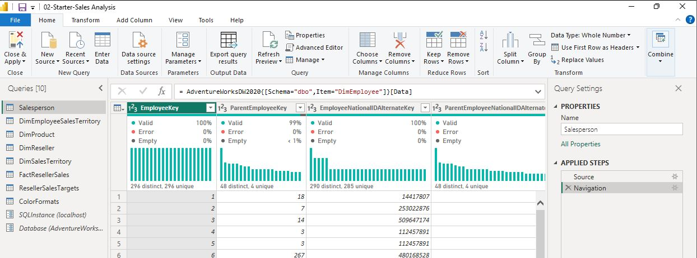

 

4. To locate a specific column, on the **Home** ribbon tab, from inside the **Manage Columns** group, select the **Choose Columns** down-arrow, and then select **Go to Column**.

>*! **Go to Column** is a useful feature with many columns. Otherwise, you can horizontally scroll to find columns.*

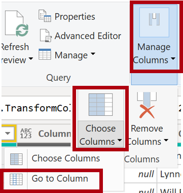

 

5. In the **Go to Column** window, to order the list by column name, select the **AZ** sort button, and then select **Name**.

 

6. Locate the **SalesPersonFlag** column, then filter the column to select only Salespeople (that is, **TRUE**), and click **OK**.

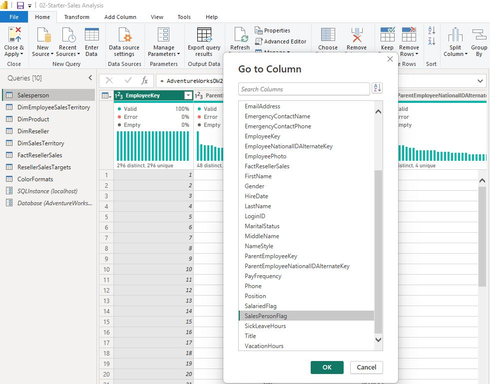

 

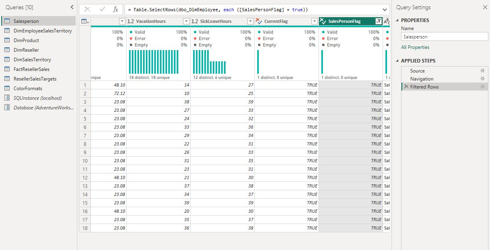

 

7. In the **Query Settings** pane, in the **Applied Steps** list, notice the addition of the **Filtered Rows** step.

>*! Each transformation you create results in another step logic. It’s possible to edit or delete steps. It’s also possible to select a step to preview the query results at that stage of the query transformation.*

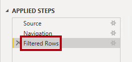

 

8. To remove columns, on the **Home** ribbon tab, from inside the **Manage Columns** group, select the **Choose Columns** icon.

9. In the **Choose Columns** window, to uncheck all columns, uncheck the **(Select All Columns)** item.

10. To include columns, check the following six columns:

   - EmployeeKey
   - EmployeeNationalIDAlternateKey
   - FirstName
   - LastName
   - Title
   - EmailAddress

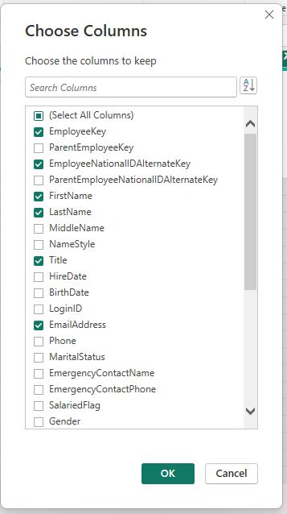

 

11. In the **Applied Steps** list, notice the addition of another query step.

 

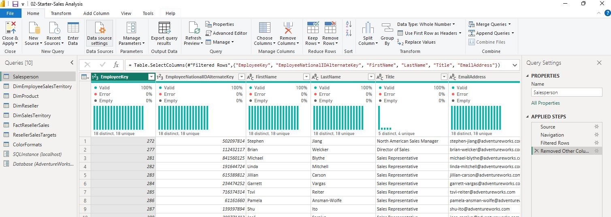

 

12. To create a single name column, first select the **FirstName** column header. While pressing the **Ctrl** key, select the **LastName** column.

 

13. Right-click either of the select column headers, and then in the context menu, select **Merge Columns**.

>*! Many common transformations can be applied by right-clicking the column header, and then choosing them from the context menu. Note that additional transformations are available in the ribbon.*

14. In the **Merge Columns** window, in the **Separator** dropdown list, select **Space**.

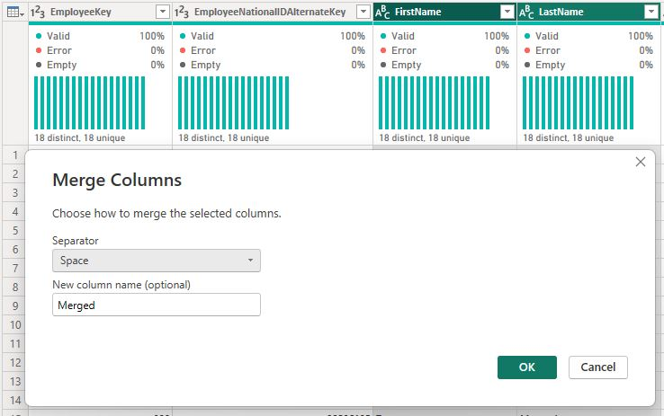

 

15. In the **New Column Name** box, replace the text with **Salesperson**.

16. To rename the **EmployeeNationalIDAlternateKey** column, double-click the **EmployeeNationalIDAlternateKey** column header and replace the text with **EmployeeID**, and then press **Enter**.

17. Rename the **EmailAddress** column to **UPN**.

>*! UPN is an acronym for User Principal Name.*

**In the status bar at the bottom-left corner of the Power Query Editor, verify that the query has 5 columns and 18 rows.**

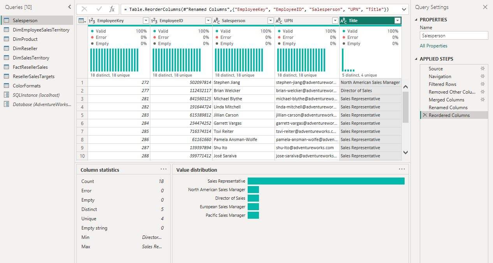

 

## Configure the SalespersonRegion query

In this task, you'll configure the **SalespersonRegion** query.

   1. In the **Queries** pane, select the **DimEmployeeSalesTerritory** query.

   2. In the **Query Settings** pane, rename the query to **SalespersonRegion**.

   3. To remove the last two columns, first select the **DimEmployee** column header.

   4. While pressing the **Ctrl** key, select the **DimSalesTerritory** column header.

   5. Right-click either of the select column headers, and then in the context menu, select **Remove Columns**.

**In the status bar, verify that the query has 2 columns and 39 rows.**

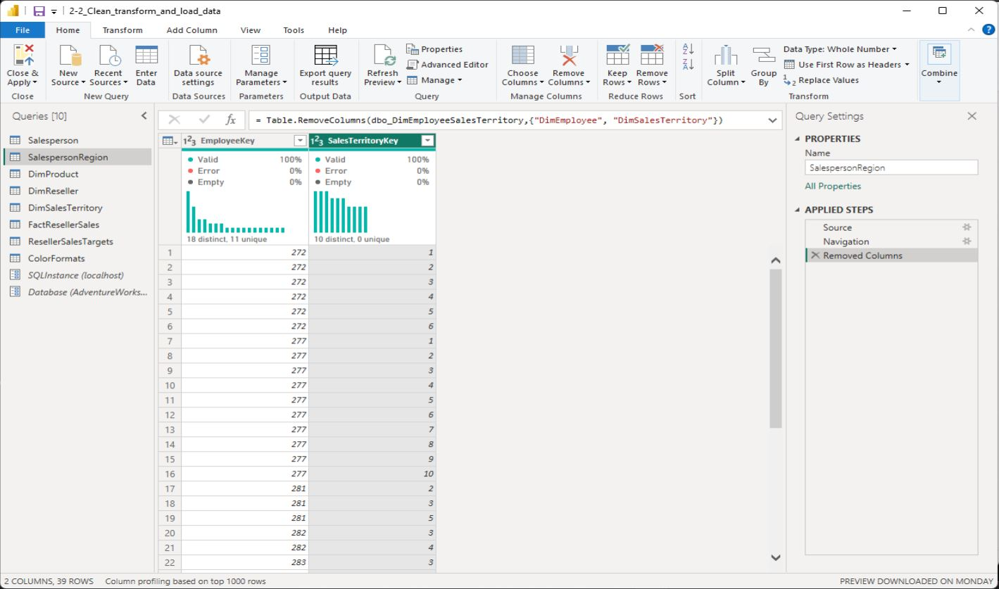

 

## Configure the Product query

In this task, you'll configure the **Product** query.

> ! **Important**: When detailed instructions have already been provided, lab steps will provide more concise instructions. If you need the detailed instructions, you can refer back to the steps of previous tasks.

1. Select the **DimProduct** query and rename the query to **Product**.

2. Locate the **FinishedGoodsFlag** column, and then filter the column to retrieve products that are finished goods (that is, TRUE).

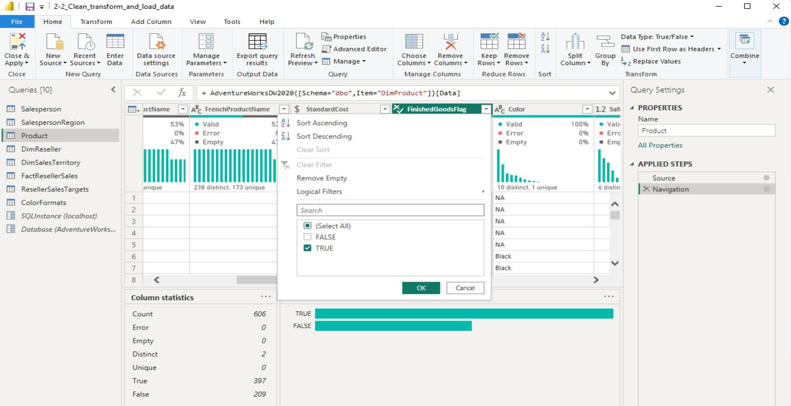

 

3. Remove all columns, **except** the following:

   - ProductKey
   - EnglishProductName
   - StandardCost
   - Color
   - DimProductSubcategory

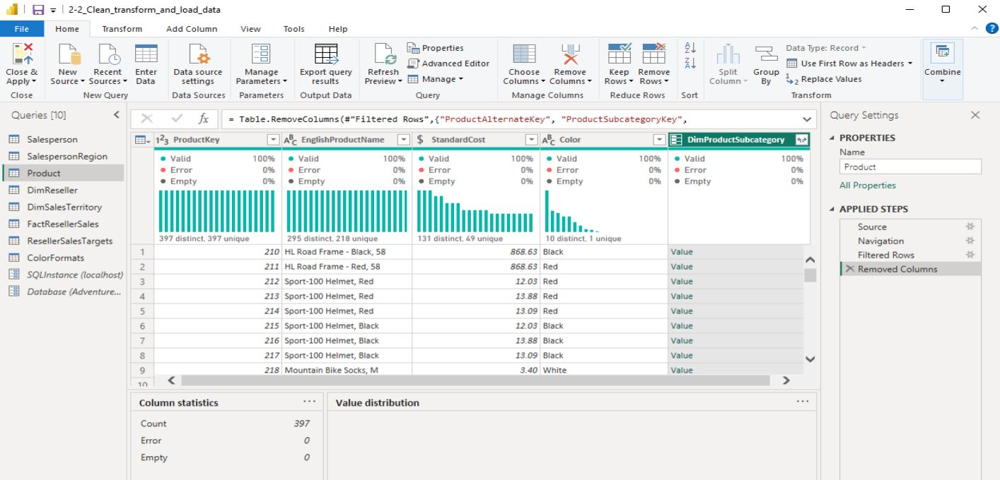

 

4. Notice that the **DimProductSubcategory** column represents a related table (it contains **Value** links).

5. In the **DimProductSubcategory** column header, at the right of the column name, select the expand button.

 

6. See the full list of columns, then select the **Select All Columns** box to unselect all columns.

7. Select **EnglishProductSubcategoryName** and **DimProductCategory**, and uncheck the **Use Original Column Name as Prefix** checkbox before selecting **OK**.

 

> By selecting these two columns, a transformation will be applied to join to the **DimProductSubcategory** table, and then include these columns. The **DimProductCategory** column is, in fact, another related table in the data source.

> Query column names must always be unique. If left checked, this checkbox would prefix each column with the expanded column name (in this case **DimProductSubcategory**). Because it’s known that the selected column names don’t collide with column names in the **Product** query, the option is deselected.

8. Notice that the transformation resulted in the addition of two columns, and that the **DimProductSubcategory** column has been removed.

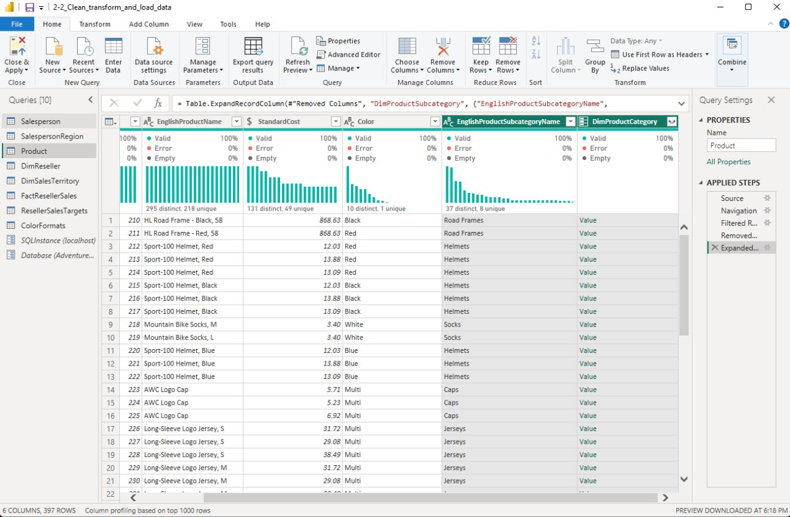

 

9. Expand the **DimProductCategory** column, and then introduce only the **EnglishProductCategoryName** column.

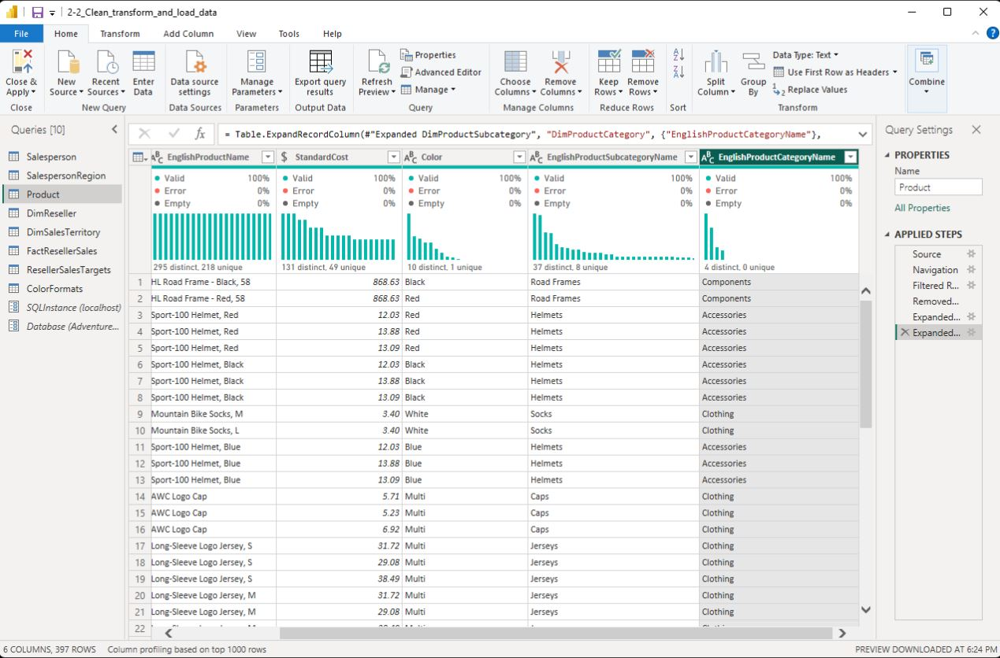

 

10. Rename the following four columns:

   - **EnglishProductName** to **Product**
   - **StandardCost** to **Standard Cost** (include a space)
   - **EnglishProductSubcategoryName** to **Subcategory**
   - **EnglishProductCategoryName** to **Category**

**In the status bar, verify that the query has 6 columns and 397 rows.**

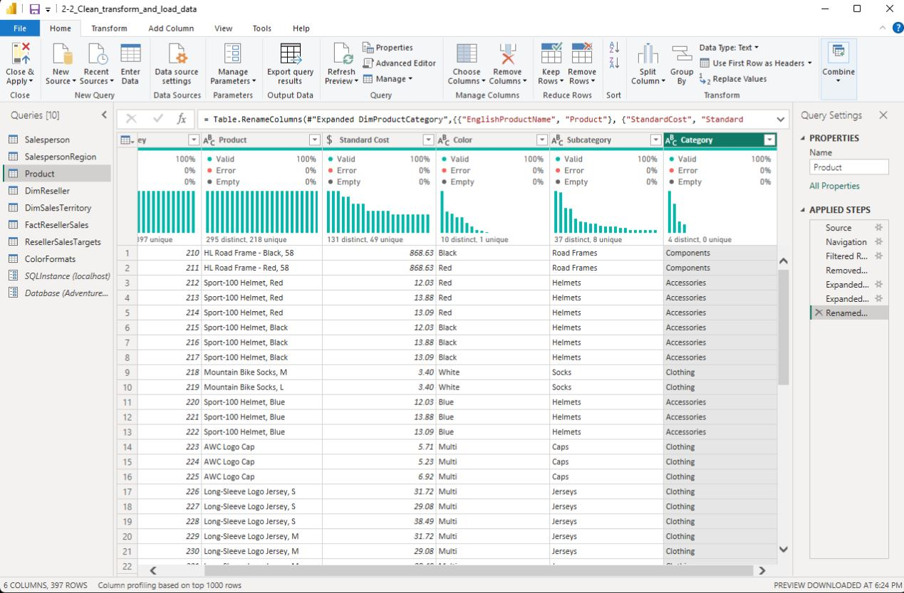

 

## Configure the Reseller query

In this task, you'll configure the **Reseller** query.

1. Select the **DimReseller** query and rename to **Reseller**.

2. Remove all columns, **except** the following:

   - ResellerKey
   - BusinessType
   - ResellerName
   - DimGeography

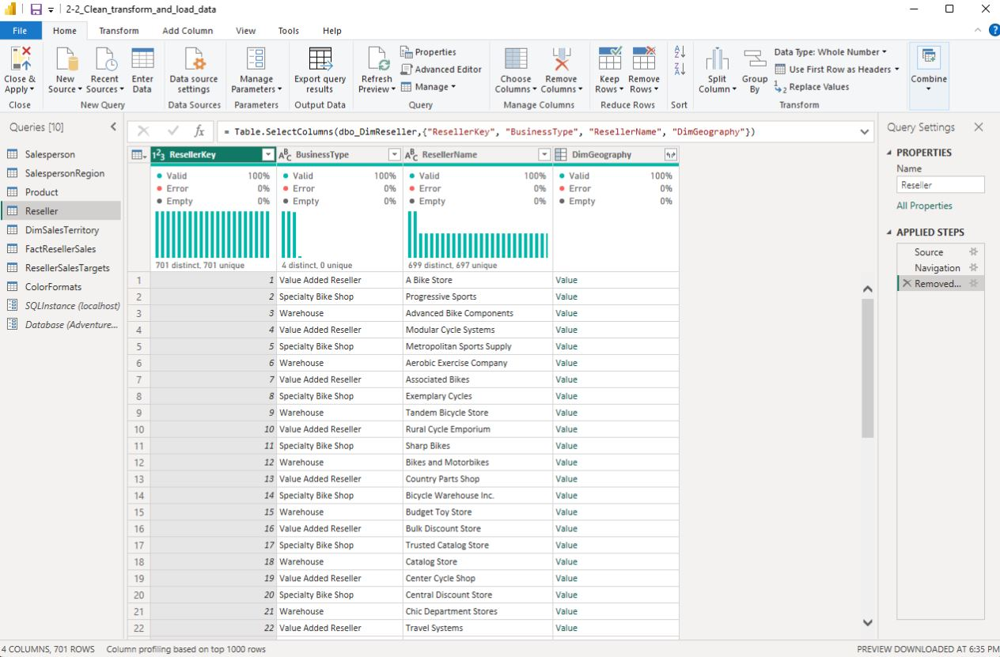

 

3. Expand the **DimGeography** column, to include **only** the following three columns:

   - City
   - StateProvinceName
   - EnglishCountryRegionName

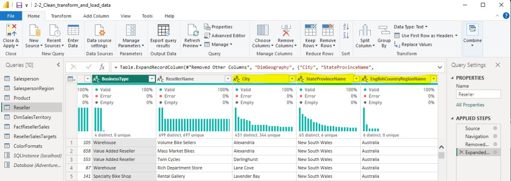

 

4. On the **BusinessType** column header, select the down-arrow, and then review the distinct column values, and notice both values **Warehouse** and **Ware House**.

5. Right-click the **BusinessType** column header, and then select **Replace Values**.

6. In the **Replace Values** window, configure the following values:

   - In the **Value to Find** box, enter **Ware House**
   - In the **Replace With** box, enter **Warehouse**

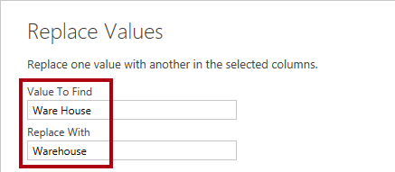

 

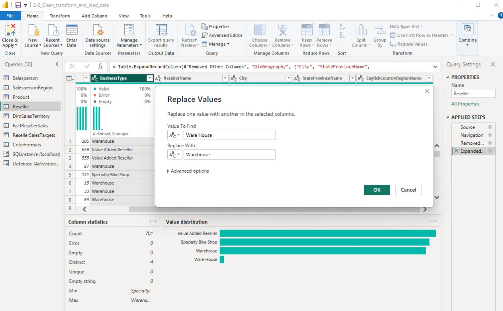

 

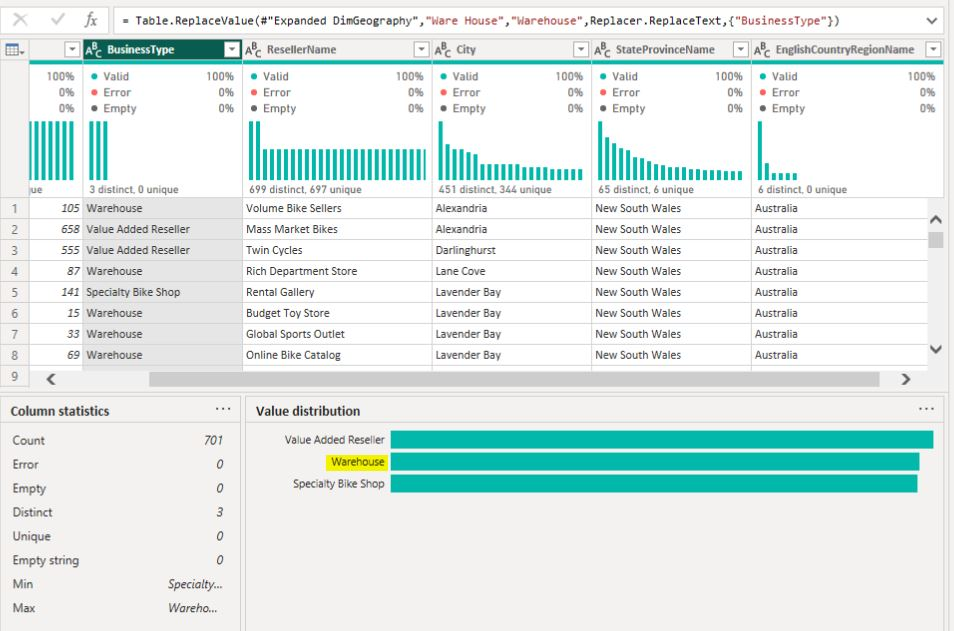

 

   1. Rename the following four columns:

      - **BusinessType** to **Business Type** (include a space)
      - **ResellerName** to **Reseller**
      - **StateProvinceName** to **State-Province**
      - **EnglishCountryRegionName** to **Country-Region**

**In the status bar, verify that the query has 6 columns and 701 rows.**

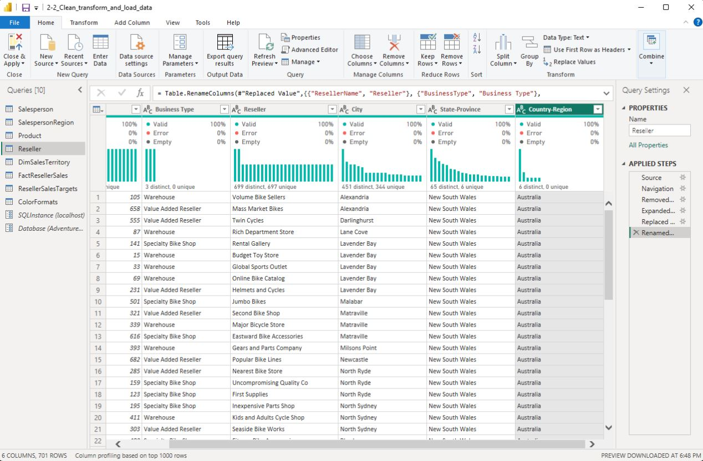

 

## Configure the Region query

In this task, you'll configure the **Region** query.

1. Select the **DimSalesTerritory** query and rename the query to **Region**.

2. Apply a filter to the **SalesTerritoryAlternateKey** column to remove the value 0 (zero).

> This will remove one row.

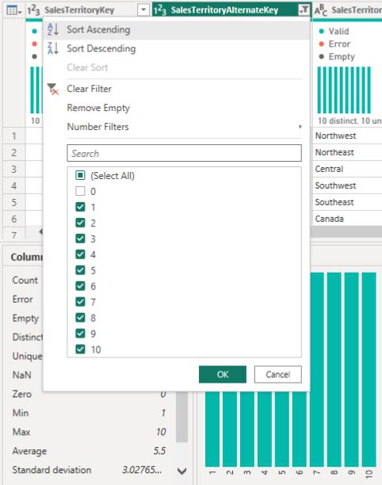

 

3. Remove all columns, **except** the following:

   - SalesTerritoryKey
   - SalesTerritoryRegion
   - SalesTerritoryCountry
   - SalesTerritoryGroup

4. Rename the following three columns:

   - **SalesTerritoryRegion** to **Region**
   - **SalesTerritoryCountry** to **Country**
   - **SalesTerritoryGroup** to **Group**

**In the status bar, verify that the query has 4 columns and 10 rows.**

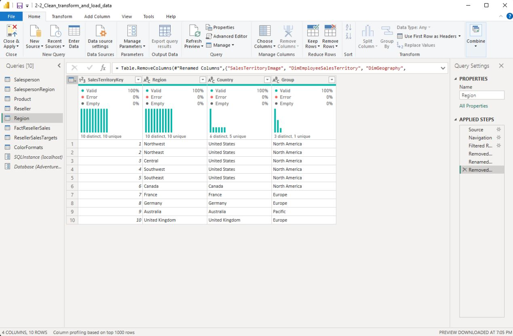

 

## Configure the Sales query

In this task, you'll configure the **Sales** query.

1. Select the **FactResellerSales** query and rename it to **Sales**.

2. Remove all columns, **except** the following:

   - SalesOrderNumber
   - OrderDate
   - ProductKey
   - ResellerKey
   - EmployeeKey
   - SalesTerritoryKey
   - OrderQuantity
   - UnitPrice
   - TotalProductCost
   - SalesAmount
   - DimProduct

> ! **Note**: You may recall in the **Prepare Data in Power BI Desktop** lab that a small percentage of **FactResellerSales** rows had missing **TotalProductCost** values. The **DimProduct** column has been included to retrieve the product standard cost column to assist fixing the missing values.

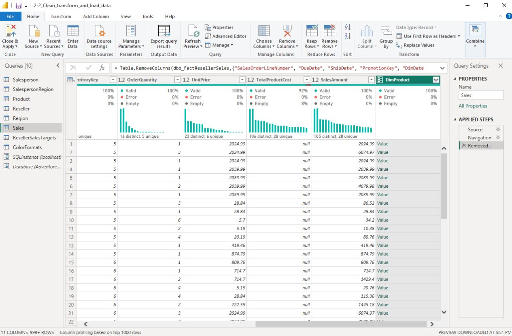

 

3. Expand the **DimProduct** column, uncheck all columns, and then include only the **StandardCost** column.

4. To create a custom column, on the **Add Column** ribbon tab, from inside the **General** group, select **Custom Column**.

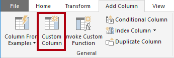

 

5. In the **Custom Column** window, in the **New Column Name** box, replace the text with **Cost**.

6. In the **Custom Column Formula** box, enter the following expression (after the equals symbol), then save the new column:

   ` if [TotalProductCost] = null then [OrderQuantity] * [StandardCost] else [TotalProductCost] `

> ! **Note**: You can copy the expression from the **Snippets.txt** file in the 02-transform-data folder.

> This expression tests if the **TotalProductCost** value is missing. If missing, it produces a value by multiplying the **OrderQuantity** value by the **StandardCost** value; otherwise, it uses the existing **TotalProductCost** value.

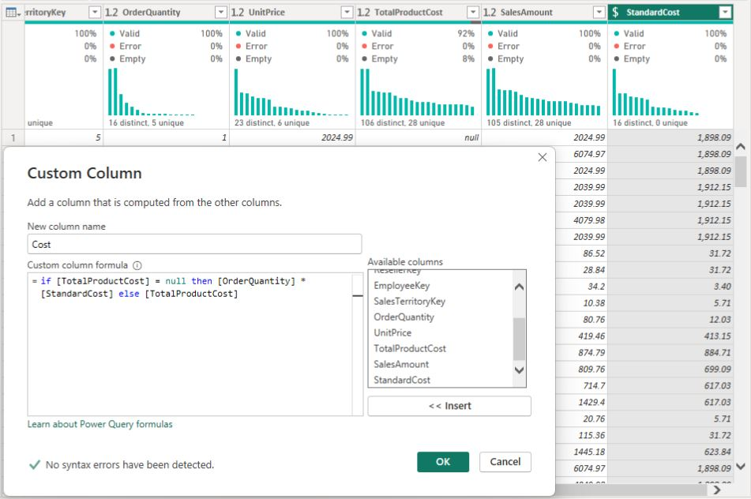

 

7. Remove the following two columns:

   - TotalProductCost
   - StandardCost

8. Rename the following three columns:

   - **OrderQuantity** to **Quantity**
   - **UnitPrice** to **Unit Price** (include a space)
   - **SalesAmount** to **Sales**

9. To modify the column data type, in the **Quantity** column header, at the left of the column name, select the **1.2** icon, and then select **Whole Number**.

> Configuring the correct data type is important. When the column contains numeric value, it’s also important to choose the correct type if you expect to perform mathematic calculations.

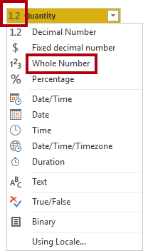

 

10. Modify the following three column data types to **Fixed Decimal Number**.

> The fixed decimal number data type allows for 19 digits, and allows for more precision to avoid rounding errors. It’s important to use the fixed decimal number type for financial values, or rates (like exchange rates).

   - Unit Price
   - Sales
   - Cost

**In the status bar, verify that the query has 10 columns and 999+ rows.** *A maximum of 1000 rows will be loaded as preview data for each query.*

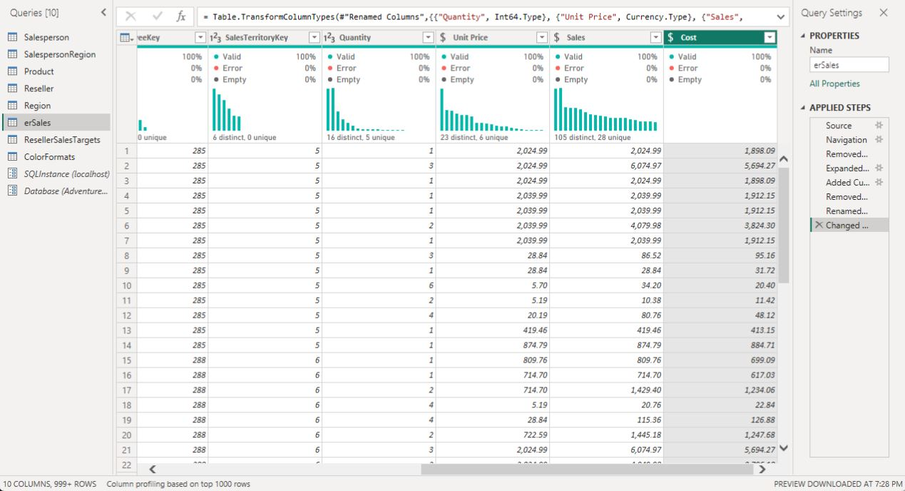

 

## Configure the Targets query

In this task, you'll configure the **Targets** query.

1. Select the **ResellerSalesTargets** query and rename to **Targets**.

> ! **Note:** If you receive a warning message asking to specify how to connect, select **Edit Credentials**, and use anonymous access.

2. To unpivot the 12 month columns (**M01**-**M12**), first multi-select the **Year** and **EmployeeID** column headers.

3. Right-click either of the select column headers, and then in the context menu, select **Unpivot Other Columns**.

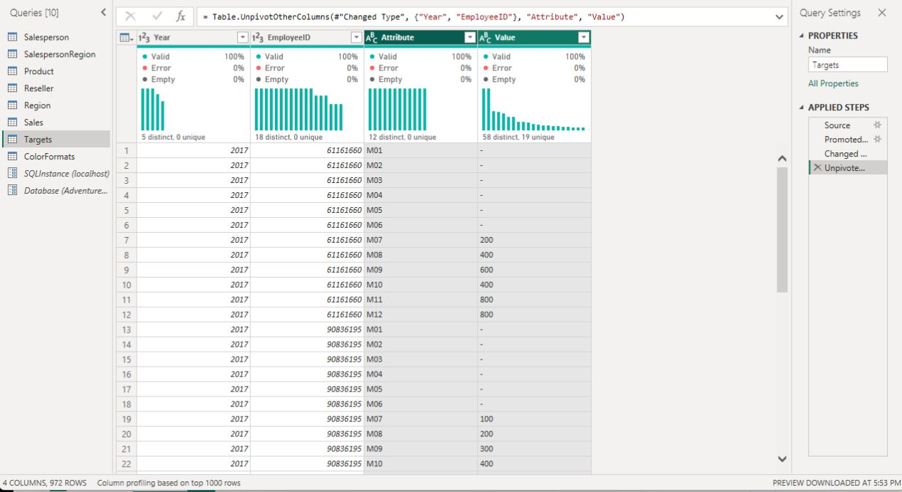

 

4. Notice that the column names now appear in the **Attribute** column, and the values appear in the **Value** column.

5. Apply a filter to the **Value** column to remove hyphen (-) values.

> You may recall that the hyphen character was used in the source CSV file to represent zero (0).

6. Rename the following two columns:

   - **Attribute** to **MonthNumber** (there's no space)
   - **Value** to **Target**

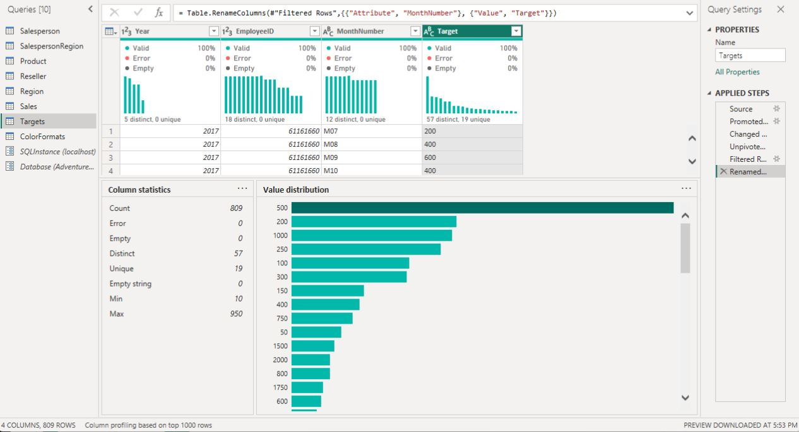

 

7. To prepare the **MonthNumber** column values, right-click the **MonthNumber** column header, and then select **Replace Values**.

> You’ll now apply transformations to produce a date column. The date will be derived from the **Year** and **MonthNumber** columns. You’ll create the column by using the **Columns From Examples** feature.

8. In the **Replace Values** window, in the **Value To Find** box, enter **M** and leave the **Replace with** empty.

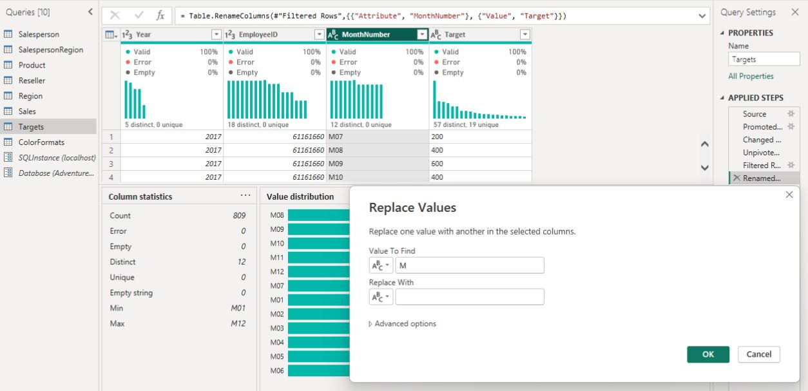

 

9. Modify the **MonthNumber** column data type to **Whole Number**.

10. On the **Add Column** ribbon tab, from inside the **General** group, select The **Column From Examples** icon.

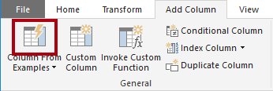

 

11. Notice that the first row is for year **2017** and month number **7**.

12. In the **Column1** column, in the first grid cell, commence entering **7/1/2017**, and then press **Enter**.

> ! **Note**: The virtual machine uses US regional settings, so this date is in fact July 1, 2017. Other regional settings may require a **0** before the date.

13. Notice that the grid cells update with predicted values.

> The feature has accurately predicted that you're combining values from the **Year** and **MonthNumber** columns.

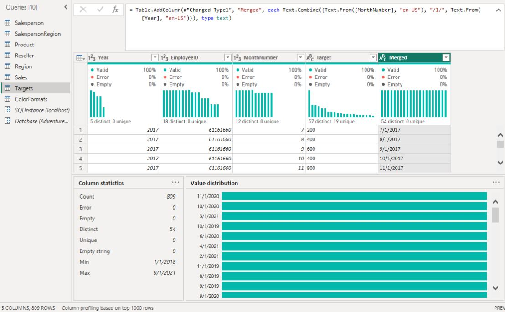

 

14. Notice also the formula presented above the query grid.

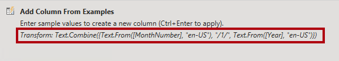

 

15. To rename the new column, double-click the **Merged** column header and rename the column as **TargetMonth**.

16. Remove the following columns:

   - Year
   - MonthNumber

17. Modify the following column data types:

   - **Target** as fixed decimal number
   - **TargetMonth** as date

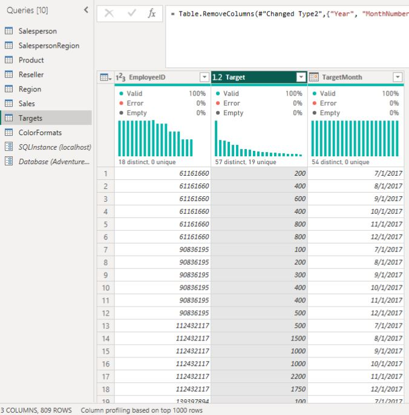

 

18. To multiply the **Target** values by 1000, select the **Target** column header, and then on the **Transform** ribbon tab, from inside the **Number Column** group, select **Standard**, and then select **Multiply**.

> You may recall that the target values were stored as thousands.

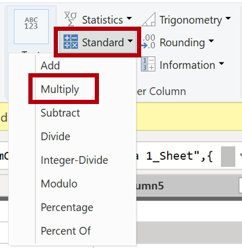

 

19. In the **Multiply** window, in the **Value** box, enter **1000**, and select **OK**.

**In the status bar, verify that the query has 3 columns and 809 rows.**

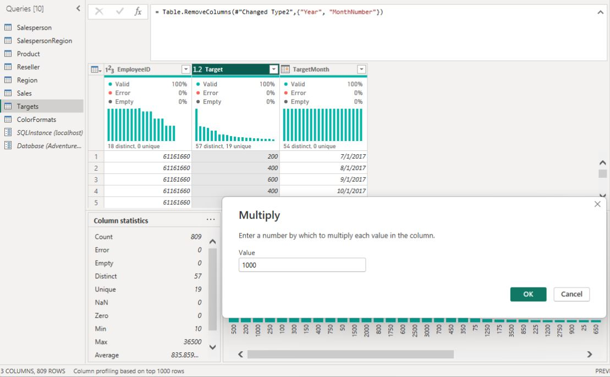

 

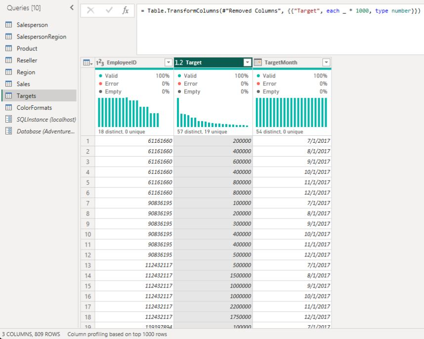

 

## Configure the ColorFormats query

In this task, you'll configure the **ColorFormats** query.

1. Select the **ColorFormats** query and notice that the first row contains the column names.

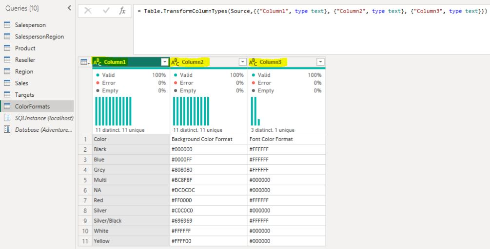

 

2. On the **Home** ribbon tab, from inside the **Transform** group, select **Use First Row as Headers**.

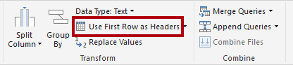

 

**In the status bar, verify that the query has 3 columns and 10 rows.**

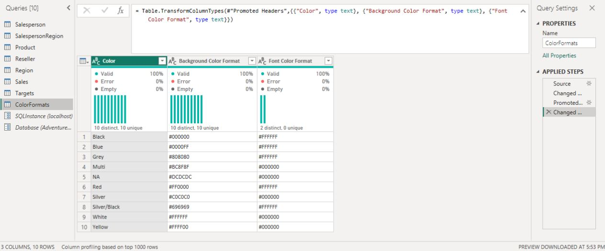

 

## Update the Product query

In this task, you'll update the **Product** query by merging the **ColorFormats** query.

1. Select the **Product** query.

2. To merge the **ColorFormats** query, on the **Home** ribbon tab, from inside the **Combine** group, select **Merge Queries**.

> Merging queries allows integrating data, in this case from different data sources (SQL Server and a CSV file).

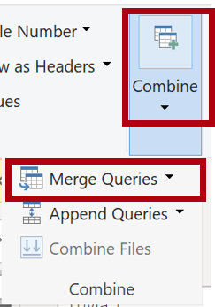

 

3. In the **Merge** window, in the **Product** query grid, select the **Color** column header.

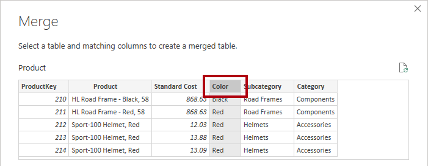

 

4. Beneath the **Product** query grid, in the dropdown list, select the **ColorFormats** query.

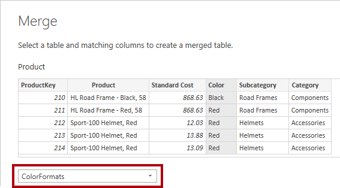

 

5. In the **ColorFormats** query grid, select the **Color** column header.

6. When the **Privacy Levels** window opens, for each of the two data sources, in the corresponding dropdown list, select **Organizational**, then **Save**.

> Privacy levels can be configured for data source to determine whether data can be shared between sources. Setting each data source as **Organizational** allows them to share data, if necessary. Private data sources can never be shared with other data sources. It doesn’t mean that Private data can't be shared; it means that the Power Query engine can't share data between the sources.

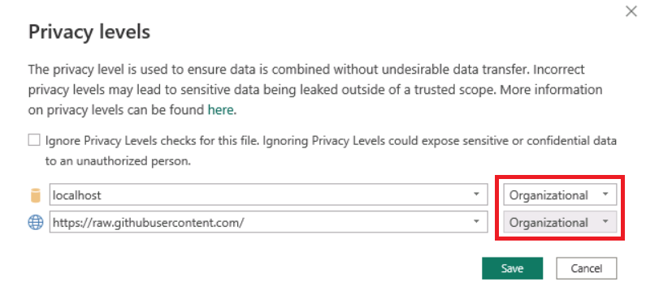

 

7. In the **Merge** window, use the default **Join Kind** - maintaining the selection of Left Outer and select **OK**.

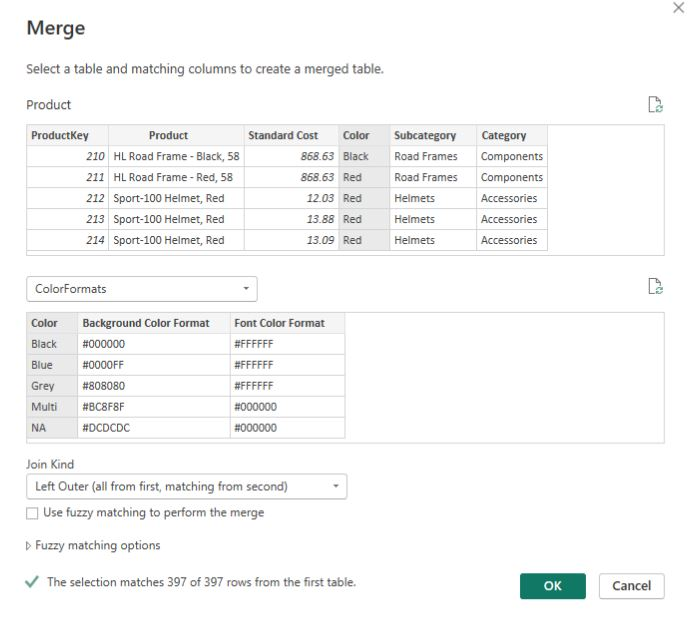

 

8. Expand the **ColorFormats** column to include the following two columns:

   - Background Color Format
   - Font Color Format

**In the status bar, verify that the query now has 8 columns and 397 rows.**

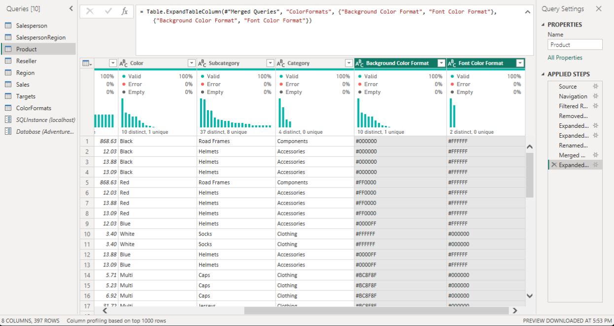

 

## Update the ColorFormats query

In this task, you'll update the **ColorFormats** to disable its load.

1. Select the **ColorFormats** query.

2. In the **Query Settings** pane, select the **All Properties** link.

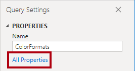

 

3. In the **Query Properties** window, uncheck the **Enable Load To Report** checkbox.

> Disabling the load means it will not load as a table to the data model. This is done because the query was merged with the **Product** query, which is enabled to load to the data model.

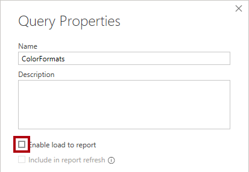

 

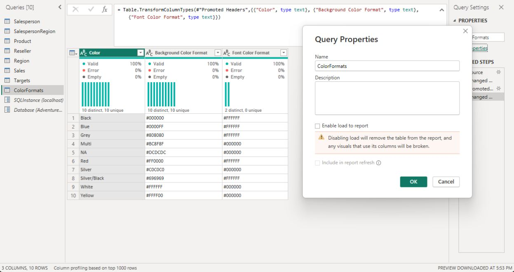

 

## Review final product

1. In Power Query Editor, verify that you have **8 queries**, correctly named as follows:

   - Salesperson
   - SalespersonRegion
   - Product
   - Reseller
   - Region
   - Sales
   - Targets
   - ColorFormats (which won't load to the data model)

2. Select **Close & Apply** to load the data to the model, and close Power Query Editor window.

 

3. You can now see the canvas in Power BI Desktop, with Filters, Visualizations, and Data panes on the right. In the Data pane, notice the **7 tables** loaded to the data model.

 

## Lab complete

You may choose to save your Power BI report, though it’s not necessary for this lab. In the next exercise, you’ll work with a pre-made starter file.

1. Navigate to the **"File"** menu in the top left corner and select **"Save As"**.
2. Select **Browse this device**.
3. Select the folder where you want to save the file and give it a descriptive name.
4. Select the **Save** button to save your report as a .pbix file.
5. If a dialog box appears prompting you to apply pending query changes, select **Apply**.
6. Close Power BI Desktop.

---

[Up](#pl-300-microsoft-power-bi-data-analyst)

---

