### PL-300 Microsoft Power-BI Data Analyst

# Create DAX calculations in semantic models

## Lab story

In this lab, you'll create calculated tables, calculated columns, and simple measures by using Data Analysis Expressions (DAX).

In this lab, you learn how to:

- Create calculated tables.
- Create calculated columns.
- Create measures.

**This lab should take approximately 45 minutes.**

## Get started

To complete this exercise, first open a web browser and enter the following URL to download the zip file:

`https://github.com/MicrosoftLearning/PL-300-Microsoft-Power-BI-Data-Analyst/raw/Main/Allfiles/Labs/04-create-dax-calculations\04-dax-calculations.zip`

Extract the file to the **C:\Users\Student\Downloads\04-dax-calculations** folder.

Open the **04-Starter-Sales Analysis.pbix** file.

> _**Note**: You may see a sign-in dialog as the file loads. Select **Cancel** to dismiss the sign-in dialog. Close any other informational windows. Select **Apply Later**, if prompted to apply changes._

<br>

## Create the Salesperson calculated table

In this task, you'll create the `Salesperson` calculated table (that will have a direct relationship to the `Sales` table).

A calculated table is created by first entering the table name, followed by the equals symbol (=), followed by a DAX formula that returns a table. The table name can't already exist in the data model.
You enter a valid DAX formula in the _formula bar_. The formula bar includes features like auto-complete, Intellisense and color-coding, which allow you to quickly and accurately enter the formula.

1. In Power BI Desktop, in **Report view**, on the **Modeling** ribbon, from inside the **Calculations** group, select **New Table**.

    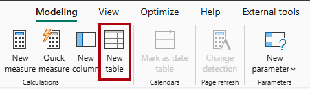

<br>

2. In the formula bar (which opens directly beneath the ribbon when you create or edit calculations), type `Salesperson =`, press **Shift+Enter**, type `'Salesperson (Performance)'`, and then press **Enter**.

    > _**Note**: For your convenience, all DAX definitions in this lab can be copied from the snippets file, located in the **04-dax-calculations\Snippets.txt** file._

    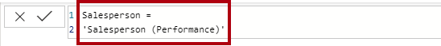

<br>

    > _This table definition creates a copy of the `Salesperson (Performance)` table. It copies the data only, however model properties like visibility, formatting, and others aren't copied._

3. In the **Data** pane, notice that the icon for the new table has an additional calculator in front of it (denoting a calculated table).

    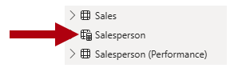

<br>

   > _**Note**: Calculated tables are defined by using a DAX formula that returns a table. It's important to understand that calculated tables increase the size of the data model because they materialize and store values. Also, they're recomputed whenever formula dependencies are refreshed, as will be the case for this data model when new (future) date values are loaded into tables._
   >
   > _Unlike Power Query-sourced tables, calculated tables can't be used to load data from external data sources. They can only transform data based on what has already been loaded into the data model._

4. Switch to **Model view**, and notice that the `Salesperson` table is available.

5. Create a relationship from the `Salesperson | EmployeeKey` column to the `Sales | EmployeeKey` column.

    > _The labs use a shorthand notation to reference a field. It will look like this: `Salesperson | EmployeeKey`. In this example, `Salesperson` is the table name and `EmployeeKey` is the column name._

6. Right-click the inactive relationship (dotted line) between the `Salesperson (Performance)` and `Sales` tables, and then select **Delete**. When prompted to confirm the deletion, select **Yes**.

7. In the `Salesperson` table, multi-select the following columns, and then hide them (set the **Is Hidden** property to _Yes_):
    - `EmployeeID`
    - `EmployeeKey`
    - `UPN`

8. In the model diagram, select the `Salesperson` table.

9. In the **Properties** pane, in the **Description** box, enter: _Salesperson related to sales_

    > _You may recall that descriptions appear as tooltips in the **Data** pane whenever the user hovers their cursor over a table or field._

10. For the `Salesperson (Performance)` table, set the description to: _Salesperson related to region(s)_

> _The data model now provides two alternatives when analyzing salespeople. The `Salesperson` table allows analyzing sales made by a salesperson, while the `Salesperson (Performance)` table allows analyzing sales made in the sales region(s) assigned to the salesperson._

   

<br>

## Create the Date table

In this task, you'll create the `Date` table.

1. Switch to **Table view**. On the **Home** ribbon tab, from inside the **Calculations** group, select **New Table**.

    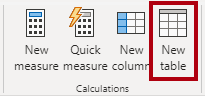

<br>

2. In the formula bar, enter the following DAX:

    ```dax
    Date =
    CALENDARAUTO(6)
    ```

    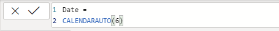

<br>

    > _The `CALENDARAUTO` function returns a single-column table comprising date values. The "auto" behavior scans all data model date columns to determine the earliest and latest date values stored in the data model. It then creates one row for each date within this range, extending the range in either direction to ensure full years of data is stored._
    >
    > _This function can take a single optional argument that is the last month number of a year. When omitted, the value is 12, meaning that December is the last month of the year. In this case, 6 is entered, meaning that June is the last month of the year._

3. Notice the column of date values which might be formatted using US regional settings (that is, mm/dd/yyyy).

    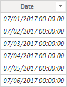

<br>

4. At the bottom-left corner, in the status bar, notice the table statistics, confirming that 1826 rows of data have been generated, which represents five full years' data.

    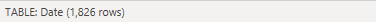

<br>

## Create calculated columns

In this task, you'll add more columns to enable filtering and grouping by different time periods. You'll also create a calculated column to control the sort order of other columns.

> _**Note**: For your convenience, all DAX definitions in this lab can be copied from the **Snippets.txt** file._

1. On the **Table Tools** contextual ribbon, from inside the **Calculations** group, select **New Column**.
    > _A calculated column is created by first entering the column name, followed by the equals symbol (=), followed by a DAX formula that returns a single-value result. The column name can't already exist in the table._

    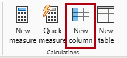

<br>

2. In the formula bar, type the following (or copy from the snippets file), and then press **Enter**:
    > _The formula uses the date's year value but adds one to the year value when the month is after June. That's how fiscal years at Adventure Works are calculated._

   ```dax
   Year =
   "FY" & YEAR('Date'[Date]) + IF(MONTH('Date'[Date]) > 6, 1)
   ```

3. Use the snippets file definitions to create the following two calculated columns for the `Date` table:

    - `Quarter`
    - `Month`

4. Verify the new columns have been added.

    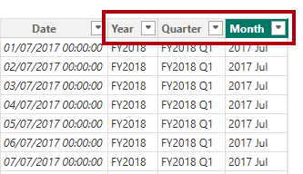

<br>

5. To validate the calculations, switch to **Report view**.

6. To create a new report page, select the plus icon next to **Page 1**.

    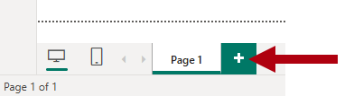

<br>

7. To add a matrix visual to the new report page, in the **Visualizations** pane, select the matrix visual type.

    > _Tip: You can hover the cursor over each icon to reveal a tooltip describing the visual type._

    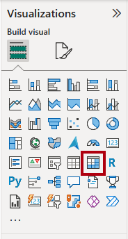

<br>

8. In the **Data** pane, from inside the `Date` table, drag the `Year` field into the **Rows** well.

    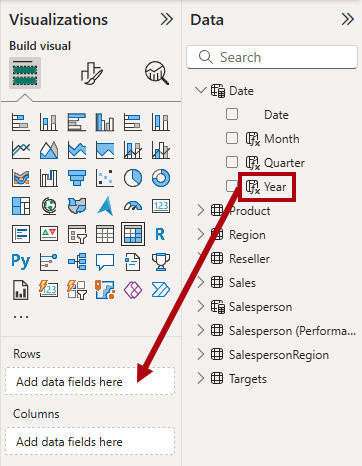

<br>

9. Drag the `Month` field into the **Rows** well, directly beneath the `Year` field.

10. At the top-right of the matrix visual (or bottom, depending on the location of the visual), select the forked-double arrow icon (which will expand all years down one level).

    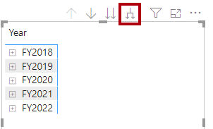

<br>

11. Notice that the years expand to months, and that the months are sorted alphabetically rather than chronologically.

    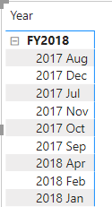

<br>

    > _By default, text values sort alphabetically, numbers sort from smallest to largest, and dates sort from earliest to latest._

12. To customize the `Month` field sort order, switch to **Table view**.

13. Add the `MonthKey` column to the `Date` table.

    ```dax
    MonthKey =
    (YEAR('Date'[Date]) * 100) + MONTH('Date'[Date])
    ```

    > _This formula computes a numeric value for each year/month combination._

14. In **Table view**, verify that the new column contains numeric values (for example, 201707 for July 2017, and so on).

    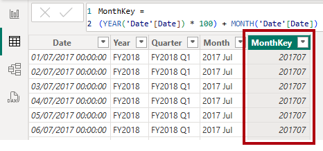

<br>

15. Switch back to **Report view**.

16. In the **Data** pane, select the `Month` field.

17. On the **Column Tools** contextual ribbon, from inside the **Sort** group, select **Sort by Column**, and then select **MonthKey**.

    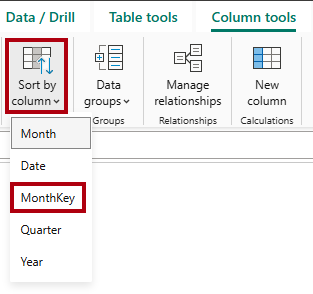

<br>

18. In the matrix visual, notice that the months are now chronologically sorted.

    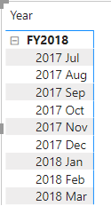

    

<br>

## Complete the Date table

In this task, you'll complete the design of the `Date` table by hiding a column and creating a hierarchy. You'll then create relationships to the `Sales` and `Targets` tables.

1. Switch to **Model view**.

2. In the `Date` table, hide the `MonthKey` column (set **Is Hidden** to _Yes_).

3. In the **Data** pane, select the `Date` table, right-click the `Year` column, and the select **Create hierarchy**.

    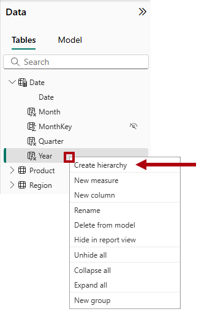

<br>

4. In the **Properties** pane, in the **Name** box, replace the value with _Fiscal_.

    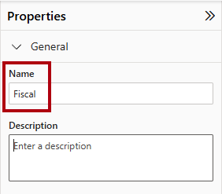

<br>

5. Two add levels to the hierarchy, in the **Hierarchy** dropdown list, select **Quarter** and then select **Month**, and then select **Apply Level Changes**.

    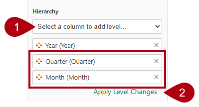

<br>

6. Create the following two model relationships:

    - `Date | Date` to `Sales | OrderDate`
    - `Date | Date` to `Targets | TargetMonth`

7. Hide the following two columns:

    - `Sales | OrderDate`
    - `Targets | TargetMonth`

    

<br>

## Mark the Date table

In this task, you'll mark the `Date` table as a date table.

1. Switch to **Report view**.

2. In the **Data** pane, select the `Date` table (not the `Date` field).

3. On the **Table Tools** contextual ribbon, from inside the **Calendars** group, select **Mark as Date Table**.

    

<br>

4. In the **Mark as a Date Table** window, slide the **Mark as a Date Table** property to _On_.

5. In the **Choose a date column** dropdown list, select **Date**.

    

<br>

6. Select **Save**.

7. Save the Power BI Desktop file.

> _Power BI Desktop now understands that this table defines date (time)._
>
> _This design approach for a date table is suitable when you don't have a date table in your data source. If you have a data warehouse, it would be appropriate to load date data from its date dimension table rather than "redefining" date logic in your data model._

   

<br>

## Create simple measures

In this task, you'll create simple measures. Simple measures aggregate values in a single column or count rows of a table.

1. In **Report view**, on **Page 2**, from the **Data** pane, drag the `Sales | Unit Price` field into the matrix visual.

    

<br>

2. In the visual fields pane (located in the **Visualizations** pane), in the **Values** well, notice that `Unit Price` field is configured as **Average of Unit Price**.

    

<br>

3. Select the down-arrow for **Average of Unit Price**, and then notice the available menu options.

    > _Visible numeric columns allow report authors at report design time to decide how column values will summarize (or not). However, it can result in inappropriate reporting._
    >
    > _Some data modelers don't like leaving things to chance, so they choose to hide these columns and instead expose aggregation logic defined in measures. It's the approach you'll now take in this lab._

4. To create a measure, in the **Data** pane, right-click the `Sales` table, and then select **New Measure**.

5. In the formula bar, add the following measure definition:

    ```DAX
    Avg Price =
    AVERAGE(Sales[Unit Price])
    ```

6. Add the `Avg Price` measure to the matrix visual, and notice that it produces the same result as the `Unit Price` column (but with different formatting).

7. In the **Values** well, open the context menu for the `Avg Price` field, and notice that it isn't possible to change the aggregation technique.

    

    > _It's not possible to modify the aggregation behavior of a measure._

8. Use the snippets file definitions to create the following five measures for the `Sales` table:

    - `Median Price`
    - `Min Price`
    - `Max Price`
    - `Orders`
    - `Order Lines`

    > _The `DISTINCTCOUNT` function used in the `Orders` measure counts orders only once (ignoring duplicates). The `COUNTROWS` function used in the `Order Lines` measure operates over a table._
    >
    > _In this case, the number of orders is calculated by counting the distinct `SalesOrderNumber` column values, while the number of order lines is simply the number of table rows (each row is a line of an order)._

9. Switch to **Model view**, and then multi-select the four price measures: `Avg Price`, `Max Price`, `Median Price`, and `Min Price`.

10. For the multi-selection of measures, configure the following requirements:

    - Set the format to two decimal places.
    - Assign to a display folder named _Pricing_ (use the **Display folder** property in the **Properties** pane).

    

<br>

11. Hide the `Unit Price` column.

    > _The `Unit Price` column is no longer available to report authors. They must use the pricing measures you've added to the model. This design approach ensures that report authors won't inappropriately aggregate prices, for example, by summing them._

12. Multi-select the `Order Lines` and `Orders` measures, and then configure the following requirements:
    - Set the format use the thousands separator.
    - Assign to a display folder named _Counts_.

    

<br>

13. In **Report view**, in the **Values** well of the matrix visual, for **Average of Unit Price**, select **X** to remove it.

    

<br>

14. Increase the size of the matrix visual to fill the page width and height.

15. Add the following five measures to the matrix visual:
    - `Median Price`
    - `Min Price`
    - `Max Price`
    - `Orders`
    - `Order Lines`

16. Verify that the results look sensible and are correctly formatted.

    

    

<br>

## Create additional measures

In this task, you'll create more measures that use more complex formulas.

1. In **Report view**, select **Page 1** and review the table visual of salespeople (on the right), noticing the total for the **Sum of Target** column.

    

<br>

2. Select the table visual, and then in the **Visualizations** pane, remove **Sum of Target**.

3. Rename the `Targets | Target` column as _TargetAmount_.

    > _Tip: There are several ways to rename the column in **Report view**: In the **Data** pane, you can right-click the column, and then select **Rename**—or, double-click the column, or press **F2**._

4. Create the following measure on the `Targets` table:

    ```dax
    Target =
    IF(
        HASONEVALUE('Salesperson (Performance)'[Salesperson]),
        SUM(Targets[TargetAmount])
    )
    ```
 
    > _The `HASONEVALUE` function tests whether a single value in the `Salesperson` column is filtered. When true, the expression returns the sum of target amounts (for just that salesperson). When false, `BLANK` is returned._

5. Format the `Target` measure for zero decimal places.

    > _Tip: You can use the **Measure Tools** contextual ribbon._

6. Hide the `TargetAmount` column.

    > _Tip: You can right-click the column in the **Data** pane, and then select **Hide**._

7. Notice that the `Targets` table now appears at the top of the list.

    

<br>

   > _Tables that comprise only visible measures are automatically listed at the top of the list._

8. Add the `Target` measure to the table visual.

9. Notice that the **Target** column total is now `BLANK`.

    

<br>

10. Use the snippets file definitions to create the following two measures for the `Targets` table:
    - `Variance`
    - `Variance Margin`

11. Format the `Variance` measure for zero decimal places.

12. Format the `Variance Margin` measure as percentage with two decimal places.

13. Add the `Variance` and `Variance Margin` measures to the table visual.

14. Resize the table visual so all columns and rows can be seen.

    

    

    > _While it appears all salespeople aren't meeting target, remember that the table visual isn't yet filtered by a specific time period. You'll produce sales performance reports that filter by a user-selected time period in the **Design a Report in Power BI Desktop** lab._

15. Save the Power BI Desktop file.

<br>

## Lab complete

You may choose to save your Power BI report, though it’s not necessary for this lab. In the next exercise, you’ll work with a pre-made starter file.

1. Navigate to the **"File"** menu in the top left corner and select **"Save As"**.
2. Select **Browse this device**.
3. Select the folder where you want to save the file and give it a descriptive name.
4. Select the **Save** button to save your report as a .pbix file.
5. If a dialog box appears prompting you to apply pending query changes, select **Apply**.
6. Close Power BI Desktop.

<br>

---

[Up](#pl-300-microsoft-power-bi-data-analyst)

---
