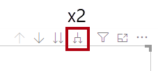
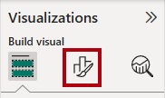
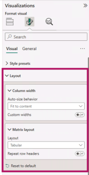
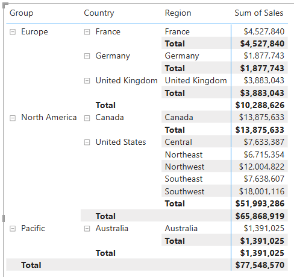
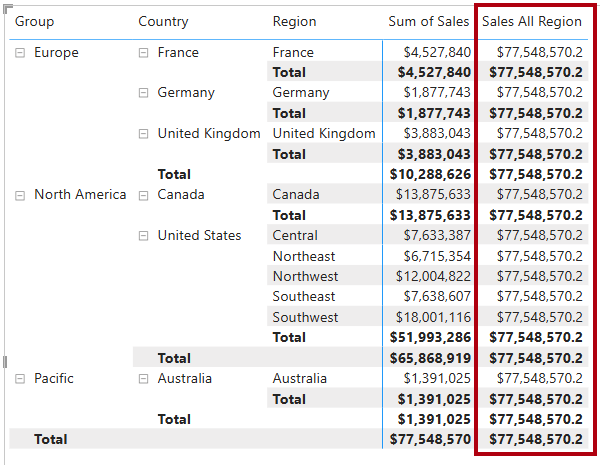
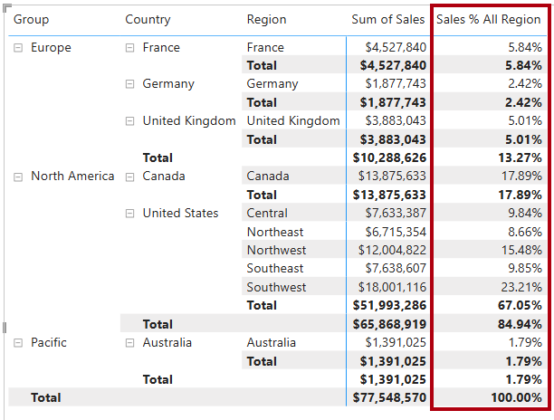
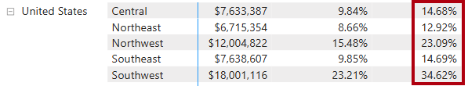
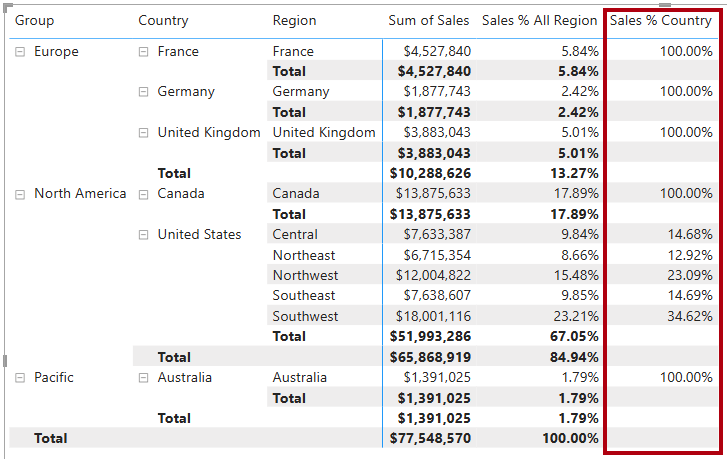
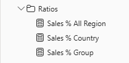

### PL-300 Microsoft Power-BI Data Analyst

# Modify DAX filter context in Power BI

## Lab story

In this lab, you’ll create measures with DAX expressions that involve filter context manipulation.

You learn how to:

-   Use the `CALCULATE` function to manipulate filter context.

**This lab should take approximately 30 minutes.**

## Get started

To complete this exercise, first open a web browser and enter the following URL to download the zip file:

`https://github.com/MicrosoftLearning/PL-300-Microsoft-Power-BI-Data-Analyst/raw/Main/Allfiles/Labs/05-modify-dax-filter-context/05-modify-dax-filter-context.zip`

Extract the file to the **C:\\Users\\Student\\Downloads\\05-modify-dax-filter-context** folder.

Open the **05-Starter-Sales Analysis.pbix** file.

> _**Note**: You may see a sign-in dialog as the file loads. Select **Cancel** to dismiss the sign-in dialog. Close any other informational windows. Select **Apply Later**, if prompted to apply changes._

<br>

## Create a matrix visual

In this task, you’ll create a matrix visual to support testing your new measures.

1.  In Power BI Desktop, create a new report page.
    
2.  On **Page 3**, add a matrix visual.
    
    


3.  Resize the matrix visual to fill the entire page.
    
4.  To configure the matrix visual fields, from the **Data** pane, drag the `Region | Regions` hierarchy, and drop it inside the visual.
    
    > The labs use a shorthand notation to reference a field or hierarchy. It will look like this: `Region | Regions`. In this example, `Region` is the table name and `Regions` is the hierarchy name.\_
    
5.  Add the `Sales | Sales` field to the **Values** well.
    
6.  To expand the entire hierarchy, at the top-right of the matrix visual, select the forked-double arrow icon twice.

    


7.  To format the visual, in the **Visualizations** pane, select the **Format** pane.
    
    


8.  In the **Search** box, enter _Layout_.
    
9.  Set the **Matrix Layout** property to _Tabular_.
    
    


10.  Verify that the matrix visual now has 4 column headers.

    


<br>

     > _At Adventure Works, the sales regions are organized into groups, countries, and regions. All countries—except the United States—have just one region, which is named after the country. As the United States is such a large sales territory, it’s divided into five sales regions._
     
You’ll create various measures in this exercise, and then test them by adding them to the matrix visual.

<br>

## Manipulate filter context

In this task, you’ll create several measures with DAX expressions that use the `CALCULATE` function to manipulate filter context.

> _The `CALCULATE` function is a powerful function you can use to manipulate the filter context. The first argument takes an expression or a measure (a measure is just a named expression). Subsequent arguments allow modifying the filter context._

1.  Add a measure to the `Sales` table, based on the following expression:
    
    > _**Note**: For your convenience, all DAX definitions in this lab can be copied from the **C:\\Users\\Student\\Downloads\\05-modify-dax-filter-context\\Snippets.txt** file._
    
    code
    
    ```
     Sales All Region =
     CALCULATE(
         SUM(Sales[Sales]),
         REMOVEFILTERS(Region)
     )
    ```
    
    > _The `REMOVEFILTERS` function removes active filters. It can take either no arguments, or a table, a column, or multiple columns as its argument._
    > 
    > _In this formula, the measure evaluates the sum of the `Sales` column in a modified filter context, which removes any filters applied to the columns of the `Region` table._
    
2.  Add the `Sales All Region` measure to the matrix visual.
    
    


3.  Notice that the measure computes the total of all region sales for each region, country (subtotal) and group (subtotal).
    
    > _The new measure is yet to deliver a useful result. When the sales for a group, country, or region is divided by this value it will produce a useful ratio known as “percent of grand total”._
    
4.  In the **Data** pane, ensure that the `Sales All Region` measure is selected (when selected, it will have a dark gray background), and then in the formula bar, replace the measure name and formula with the following formula:
    
    > _Tip: To replace the existing formula, first copy the snippet. Then, select inside the formula bar and press **Ctrl+A** to select all text. Then, press **Ctrl+V** to paste the snippet to overwrite the selected text. Then press **Enter**._
    
    code
    
    ```
     Sales % All Region =
     DIVIDE(
         SUM(Sales[Sales]),
         CALCULATE(
             SUM(Sales[Sales]),
             REMOVEFILTERS(Region)
         )
     )
    ```
    
    > _The measure has been renamed to accurately reflect the updated formula. The `DIVIDE` function divides the sum of the `Sales` column (not modified by filter context) by the sum of the `Sales` column in a modified context, which removes any filters applied to the `Region` table._
    
5.  In the matrix visual, notice that the measure has been renamed and that a different value now appears for each group, country, and region.
    
6.  Format the `Sales % All Region` measure as a percentage with two decimal places.
    
7.  In the matrix visual, review the `Sales % All Region` measure values.
    
    


8.  Add another measure to the `Sales` table, based on the following expression, and format as a percentage:
    
    code
    
    ```
     Sales % Country =
     DIVIDE(
         SUM(Sales[Sales]),
         CALCULATE(
             SUM(Sales[Sales]),
             REMOVEFILTERS(Region[Region])
         )
     )
    ```
    
9.  Notice that the `Sales % Country` measure formula differs slightly from the `Sales % All Region` measure formula.
    
    > _The difference is that the denominator modifies the filter context by removing filters on the `Region` column of the `Region` table, not all columns of the `Region` table. That means that any filters applied to the group or country columns are preserved. It will achieve a result that represents the sales as a percentage of country._
    
10.  Add the `Sales % Country` measure to the matrix visual.
     
11.  Notice that only the regions of the United States produce a value that isn’t 100 percent.

     

<br>

     > _You might recall that only the United States has multiple regions. All other countries comprise a single region, which explains why they’re all 100 percent._
     
12.  To improve the readability of this measure in visual, overwrite the `Sales % Country` measure with the following improved formula.
     
     code
     
     ```
      Sales % Country =
      IF(
          ISINSCOPE(Region[Region]),
          DIVIDE(
              SUM(Sales[Sales]),
              CALCULATE(
                  SUM(Sales[Sales]),
                  REMOVEFILTERS(Region[Region])
              )
          )
      )
     ```
     
     > _The `IF` function uses the `ISINSCOPE` function to test whether the region column is the level in a hierarchy of levels. When true, the `DIVIDE` function is evaluated. When false, `BLANK` is returned because the region column isn’t in scope._
     
13.  Notice that the `Sales % Country` measure now only returns a value when a region is in scope.
     
     
     

14.  Add another measure to the `Sales` table, based on the following expression, and format as a percentage:
     
     code
     
     ```
      Sales % Group =
      DIVIDE(
          SUM(Sales[Sales]),
          CALCULATE(
              SUM(Sales[Sales]),
              REMOVEFILTERS(
                  Region[Region],
                  Region[Country]
              )
          )
      )
     ```
     
     > _To achieve sales as a percentage of group, two filters can be applied to effectively remove the filters on two columns._
     
15.  Add the `Sales % Group` measure to the matrix visual.
     
16.  To improve the readability of this measure in visual, overwrite the `Sales % Group` measure with the following formula.
     
     code
     
     ```
      Sales % Group =
      IF(
          ISINSCOPE(Region[Region])
              || ISINSCOPE(Region[Country]),
          DIVIDE(
              SUM(Sales[Sales]),
              CALCULATE(
                  SUM(Sales[Sales]),
                  REMOVEFILTERS(
                      Region[Region],
                      Region[Country]
                  )
              )
          )
      )
     ```
     
17.  Notice that the `Sales % Group` measure now only returns a value when a region or country is in scope.
     
18.  In **Model view**, place the three new measures into a display folder named _Ratios_.
     
     


19.  Save the Power BI Desktop file.
     

> _The measures added to the `Sales` table have modified filter context to achieve hierarchical navigation. Notice that the pattern to achieve the calculation of a subtotal requires removing some columns from the filter context, and to arrive at a grand total, all columns must be removed._

## Lab complete

You may choose to save your Power BI report, though it’s not necessary for this lab. In the next exercise, you’ll work with a pre-made starter file.

1.  Navigate to the **“File”** menu in the top left corner and select **“Save As”**.
2.  Select **Browse this device**.
3.  Select the folder where you want to save the file and give it a descriptive name.
4.  Select the **Save** button to save your report as a .pbix file.
5.  If a dialog box appears prompting you to apply pending query changes, select **Apply**.
6.  Close Power BI Desktop.

---
*Source: [Modify DAX filter context in Power BI](https://microsoftlearning.github.io/PL-300-Microsoft-Power-BI-Data-Analyst/Instructions/Labs/05-modify-dax-filter-context.html)*

<br>

---

[Up](#pl-300-microsoft-power-bi-data-analyst)

---

