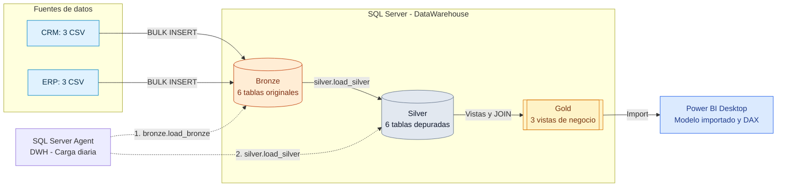
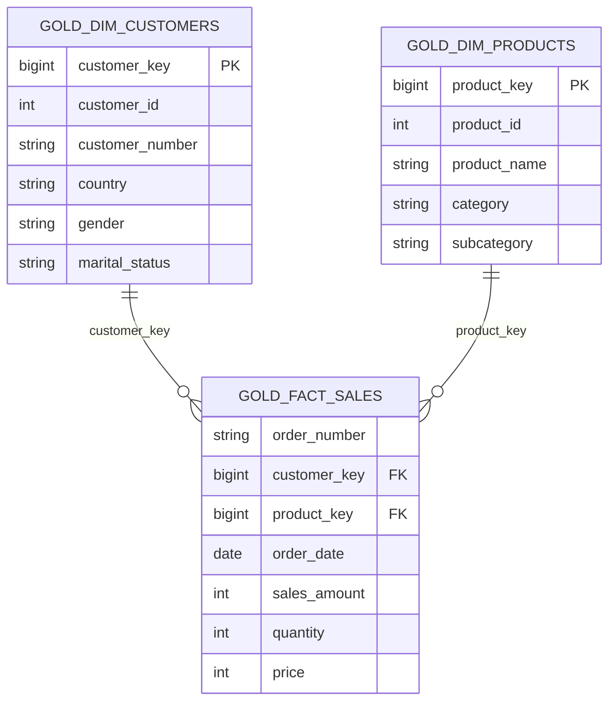
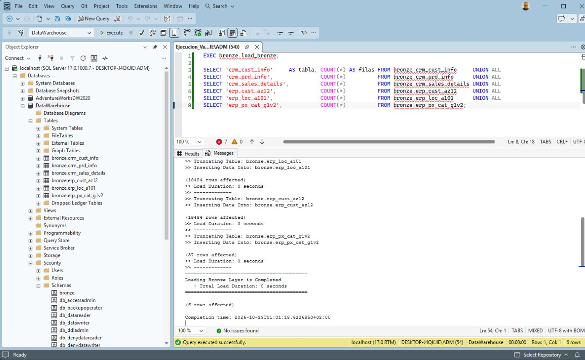
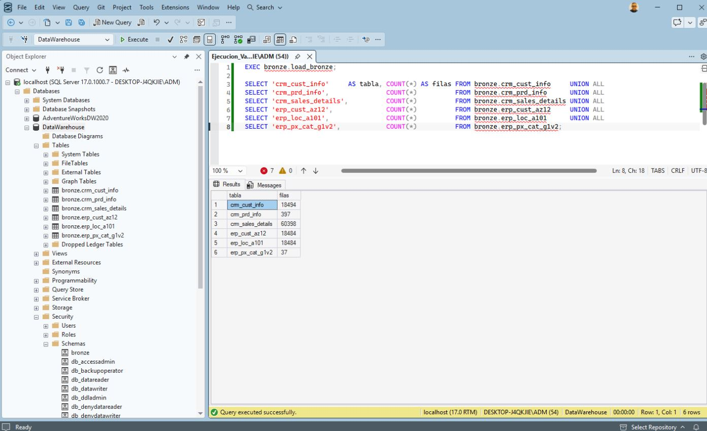
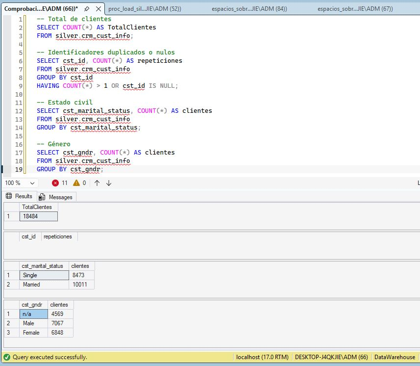
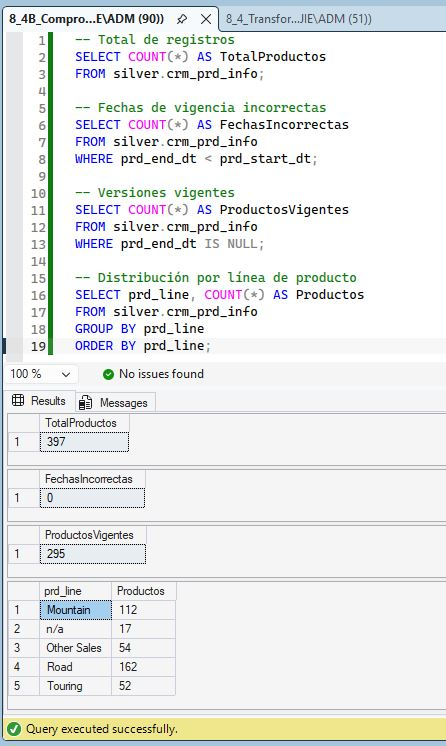
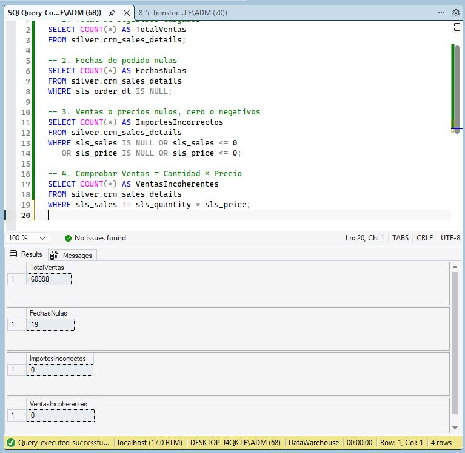
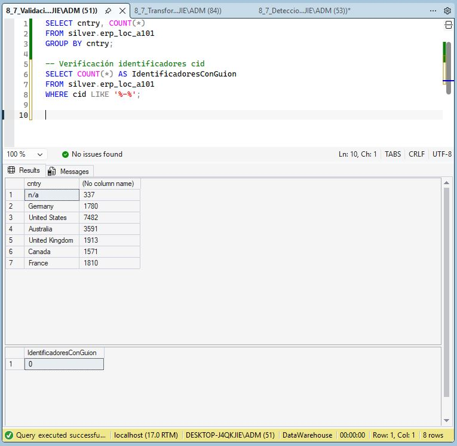
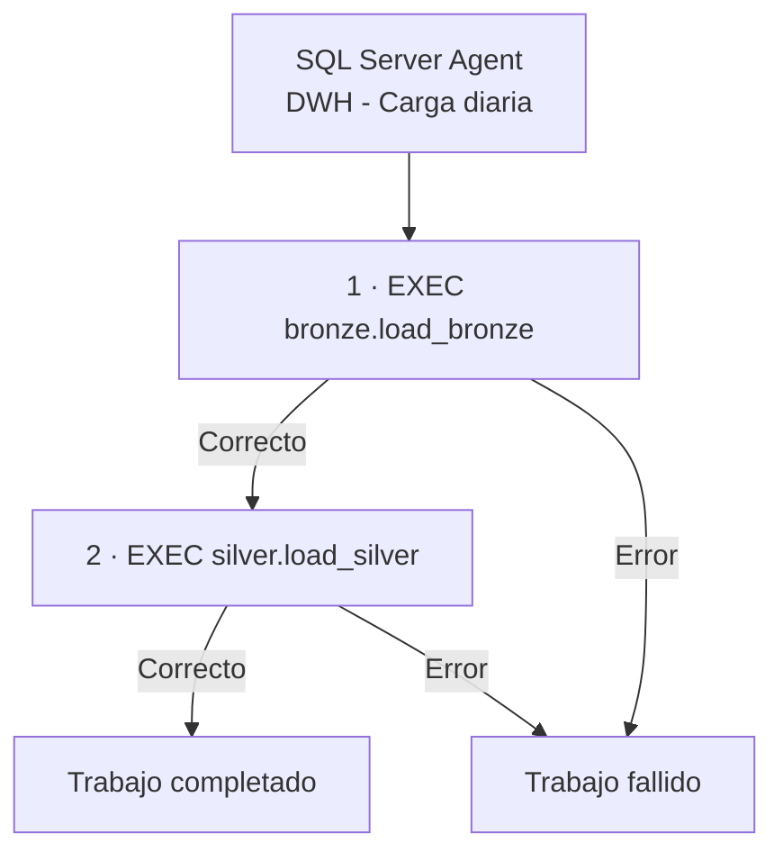
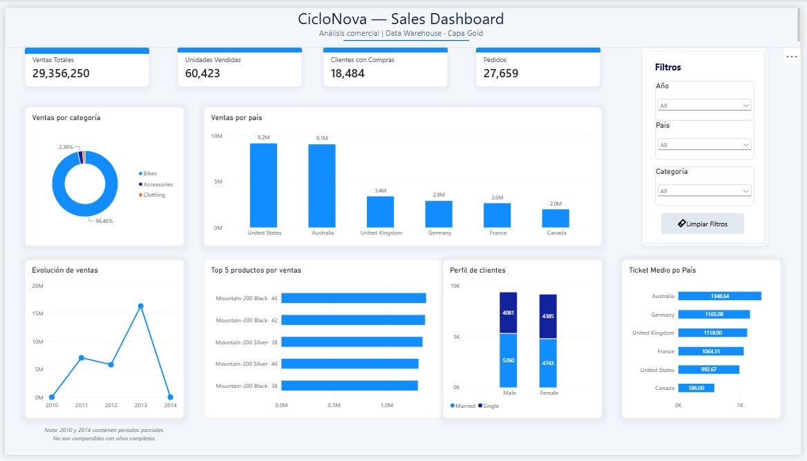

# CicloNova — Data Warehouse y Sales Dashboard

**Proyecto final de Data Engineering y Business Intelligence | SQL Server · T-SQL · SQL Server Agent · Power BI**

Proyecto de integración y análisis de datos para **CicloNova**, una empresa ficticia que necesita consolidar información de su **CRM** y su **ERP**. A partir de seis archivos CSV se construye un Data Warehouse local con arquitectura **Medallion (Bronze → Silver → Gold)**, un **modelo dimensional en estrella**, cargas automatizadas y un dashboard interactivo de ventas.

> **Estado del proyecto:** capas Bronze, Silver y Gold implementadas; pruebas realizadas; carga con SQL Server Agent verificada; dashboard de Power BI completado; documentación técnica preparada. Este repositorio corresponde a un ejercicio formativo, no a un despliegue productivo.

## 1. Objetivos y alcance

- Integrar datos de clientes, productos, ventas, localizaciones y categorías procedentes de dos sistemas.
- Conservar los datos de entrada en **Bronze** y depurarlos en **Silver**.
- Exponer datos de negocio desde **Gold** mediante dos dimensiones y una vista de hechos.
- Validar la calidad de la información y contrastar métricas con consultas SQL.
- Automatizar la ejecución ordenada de las cargas con **SQL Server Agent**.
- Analizar ventas, pedidos, clientes y productos mediante **Power BI Desktop**.
- Documentar arquitectura, linaje, modelo de datos, catálogo y convenciones de nombres.

**Entorno:** SQL Server y Power BI Desktop en entorno local (VM Windows); base de datos `DataWarehouse`, instancia `localhost`. Las capas Bronze y Silver contienen **tablas físicas**; Gold está implementada con **vistas SQL**. Los importes se presentan sin símbolo monetario porque el ejercicio no establece una moneda.

## 2. Arquitectura de la solución



| Capa | Objetivo | Implementación |
|---|---|---|
| **Bronze** | Ingesta de los CSV | 6 tablas; procedimiento `bronze.load_bronze` |
| **Silver** | Limpieza, estandarización y controles | 6 tablas; procedimiento `silver.load_silver` |
| **Gold** | Exposición de datos analíticos | 3 vistas: `gold.dim_customers`, `gold.dim_products`, `gold.fact_sales` |
| **Consumo** | Indicadores e interacción | Power BI en modo Import, medidas DAX y segmentadores |

Documentación detallada: [Arquitectura Medallion](docs/architecture.md) · [Linaje de datos](docs/data_lineage.md).

## 3. Sistemas origen y volúmenes

| Sistema | Archivo CSV | Registros de origen |
|---|---|---:|
| CRM | `cust_info.csv` | 18.494 |
| CRM | `prd_info.csv` | 397 |
| CRM | `sales_details.csv` | 60.398 |
| ERP | `CUST_AZ12.csv` | 18.484 |
| ERP | `LOC_A101.csv` | 18.484 |
| ERP | `PX_CAT_G1V2.csv` | 37 |

Los archivos se organizan en [`datasets/source_crm/`](datasets/source_crm/) y [`datasets/source_erp/`](datasets/source_erp/). La carga se efectúa con `BULK INSERT` mediante el procedimiento de Bronze y está preparada para las rutas locales configuradas en dicho script.

## 4. Modelo dimensional en estrella

El modelo analítico relaciona la vista de hechos de ventas con dos dimensiones. La **granularidad** de `gold.fact_sales` es **una línea de pedido**.



- **`gold.dim_customers`:** integra atributos de clientes del CRM con género, fecha de nacimiento y país procedentes del ERP.
- **`gold.dim_products`:** combina el catálogo de productos del CRM con las categorías y subcategorías del ERP; representa los productos vigentes.
- **`gold.fact_sales`:** expone líneas de venta enlazadas con las dimensiones mediante `customer_key` y `product_key`.

En Power BI se establecieron relaciones **muchos a uno (`*:1`)**, activas, con filtrado en una dirección desde dimensiones hacia hechos. Las claves subrogadas se calculan en las vistas Gold con `ROW_NUMBER()`; al no estar materializadas, su estabilidad entre recargas no está garantizada.

Más información: [Modelo de datos](docs/data_model.md) · [Catálogo de datos Gold](docs/data_catalog.md).

## 5. Preparación, transformaciones y calidad

La ingesta y las transformaciones se implementaron con scripts T-SQL agrupados por capa. Las pruebas incluyen controles de valores no válidos, claves entre sistemas, fechas y coherencia de los importes.

| Comprobación | Resultado |
|---|---:|
| Clientes depurados en Silver y expuestos en Gold | 18.484 |
| Registros de productos en Silver (incluidas versiones) | 397 |
| Productos vigentes en Gold | 295 |
| Líneas de venta en Gold | 60.398 |
| Ventas sin fecha válida de pedido | 19 |
| Claves de clientes ERP sin correspondencia CRM | 0 |
| Líneas Gold con importe nulo, no positivo o incoherente con cantidad × precio | 0 |
| Productos Gold sin categoría asociada en ERP | 7 |

**Incidencia de calidad identificada:** siete productos de tipo *pedales*, asociados al código de categoría `CO_PE`, no encuentran correspondencia en el catálogo del ERP. Esta limitación se conserva documentada; no se inventa una categoría.

Los datos con fecha de pedido `NULL` participan en los KPI globales, pero no en el desglose por año. Los valores `n/a` permanecen en el modelo, aunque se ocultan en ciertos gráficos de Power BI para facilitar su lectura.

Scripts de validación: [`quality_checks_silver.sql`](tests/quality_checks_silver.sql) y [`quality_checks_gold.sql`](tests/quality_checks_gold.sql).

### 5.1. Evidencias de la capa Bronze

La capa Bronze conserva los datos originales procedentes de los sistemas CRM y ERP en seis tablas físicas de SQL Server.

La ingesta se realiza mediante `BULK INSERT`, utilizando el procedimiento almacenado `bronze.load_bronze`.

**Ejecución del procedimiento de carga Bronze**

La ejecución del procedimiento finaliza correctamente, confirmando la carga de los datos de origen.



**Validación de las seis tablas Bronze**

Se comprueba que las seis tablas contienen los registros esperados, coincidiendo con los volúmenes originales de los archivos CSV.



<br>

### 5.2. Evidencias de la capa Silver

La capa Silver transforma, limpia y estandariza los datos originales de Bronze mediante el procedimiento almacenado `silver.load_silver`.

Se aplican reglas de calidad para eliminar duplicados, normalizar atributos, corregir formatos y garantizar la coherencia de los datos antes de su exposición en Gold.

**Validación de clientes**

Se comprueba que la tabla `silver.crm_cust_info` contiene 18.484 clientes, sin identificadores duplicados o nulos. También se verifica la distribución de los atributos de género y estado civil.



**Validación de productos**

Se comprueba que la tabla `silver.crm_prd_info` contiene 397 versiones de productos, de las cuales 295 están vigentes, sin inconsistencias en sus periodos de validez.



**Validación de ventas**

La tabla `silver.crm_sales_details` contiene 60.398 líneas de venta. Las comprobaciones identifican 19 registros sin fecha de pedido y confirman que no existen importes incorrectos ni diferencias entre ventas, cantidades y precios.



**Normalización de países del ERP**

La tabla `silver.erp_loc_a101` contiene los países normalizados, correspondientes a seis países identificados y el valor `n/a`. También se comprueba que los identificadores de cliente no conservan guiones.



<br>

## 6. Automatización — SQL Server Agent

Se creó el trabajo **`DWH - Carga diaria`**, programado para ejecutarse **todos los días a las 06:00**, con dos pasos secuenciales:



Los procedimientos incluyen propagación de errores mediante `THROW;`. **Se verificó una ejecución correcta de ambos pasos** mediante la ejecución del trabajo y la consulta de su historial. Puesto que Gold está constituida por vistas, no es necesario un tercer paso de carga de datos Gold.

**Importante:** la ejecución programada exige que la VM, SQL Server y SQL Server Agent permanezcan activos a la hora establecida.

Script: [`scripts/automation/job_carga_diaria.sql`](scripts/automation/job_carga_diaria.sql).

## 7. Resultados del análisis

### Indicadores generales

| Indicador | Resultado |
|---|---:|
| **Ventas totales** | **29.356.250** |
| **Unidades vendidas** | **60.423** |
| **Pedidos distintos** | **27.659** |
| **Clientes con compras** | **18.484** |
| **Ticket medio por pedido** | **1.061,36** |

### Ventas por categoría

| Categoría | Ventas | Peso aproximado |
|---|---:|---:|
| Bikes | 28.316.272 | 96,46 % |
| Accessories | 700.262 | 2,39 % |
| Clothing | 339.716 | 1,16 % |

La categoría **Bikes** concentra la mayor parte de las ventas.

### Ventas y ticket medio por país

El análisis identifica a **Estados Unidos y Australia** como los dos principales mercados por importe. El **ticket medio por pedido de Australia (1.348,64)** supera al de **Estados Unidos (992,67)**, resultado del ejercicio adicional de la Sección 13.

### Evolución temporal

Los datos incluyen ventas de **2010 a 2014**, pero **2010 y 2014 son períodos parciales**. Por ello, su comparación directa con años completos puede inducir a conclusiones equivocadas. Además, 19 líneas sin fecha válida no se incluyen en los gráficos de evolución por año.

## 8. Dashboard de Power BI

Se desarrolló **`CicloNova — Sales Dashboard`**, conectado a las vistas Gold de `DataWarehouse` en modo **Import**.

**Componentes:**

- Cuatro tarjetas KPI: ventas totales, unidades, clientes y pedidos.
- Seis gráficos: ventas por categoría, ventas por país, evolución anual, Top 5 de productos, perfil de clientes y ticket medio por país.
- Tres segmentadores interactivos: **Año**, **País** y **Categoría**.
- Botón **Limpiar Filtros** para restablecer las selecciones.

Medidas DAX principales:

```dax
Ventas Totales = SUM('gold fact_sales'[sales_amount])

Unidades Vendidas = SUM('gold fact_sales'[quantity])

Pedidos = DISTINCTCOUNT('gold fact_sales'[order_number])

Clientes con Compras = DISTINCTCOUNT('gold fact_sales'[customer_key])

Ticket Medio = DIVIDE([Ventas Totales], [Pedidos], 0)
```

**Archivo de Power BI:** [`powerbi/CicloNova_Dashboard.pbix`](powerbi/CicloNova_Dashboard.pbix).

### Dashboard final



<br>

## 9. Organización del repositorio

La estructura conserva las carpetas originales del ejercicio e incorpora las ampliaciones del proyecto (**automatización**, **Power BI** y **evidencias**):

```text
Proyecto_Final_CicloNova/
├── README.md
├── Proyecto_Final_SQL_Server_PowerBI.md
├── datasets/
│   ├── source_crm/
│   └── source_erp/
├── docs/
│   ├── architecture.md
│   ├── data_lineage.md
│   ├── data_model.md
│   ├── data_catalog.md
│   └── naming_conventions.md
├── images/
│   ├── bronze/
│   ├── silver/
│   ├── gold/
│   ├── automation/
│   └── powerbi/
├── powerbi/
│   └── CicloNova_Dashboard.pbix
├── scripts/
│   ├── init_database.sql
│   ├── bronze/
│   │   ├── ddl_bronze.sql
│   │   └── proc_load_bronze.sql
│   ├── silver/
│   │   ├── ddl_silver.sql
│   │   └── proc_load_silver.sql
│   ├── gold/
│   │   └── ddl_gold.sql
│   └── automation/
│       └── job_carga_diaria.sql
└── tests/
    ├── quality_checks_silver.sql
    └── quality_checks_gold.sql
```

> La estructura indica la organización acordada para el proyecto. Antes de activar los enlaces de evidencias, se debe verificar la presencia de cada imagen en la carpeta correspondiente.

## 10. Documentación técnica y evidencias

| Documento | Qué contiene |
|---|---|
| [Arquitectura](docs/architecture.md) | Componentes, capas Medallion y ejecución de cargas |
| [Linaje de datos](docs/data_lineage.md) | Recorrido desde CRM/ERP hasta Gold y Power BI |
| [Modelo dimensional](docs/data_model.md) | Esquema estrella, grano, claves y relaciones |
| [Catálogo de datos](docs/data_catalog.md) | Columnas, tipos, significado y procedencia de Gold |
| [Convenciones de nombres](docs/naming_conventions.md) | Reglas para SQL, archivos y artefactos |

Las capturas del desarrollo se organizan en [`images/`](images/), separadas por capa o componente. Entre las evidencias del dashboard figuran las validaciones de medidas, los segmentadores y la captura final `FPBI_016_Dashboard_Final.JPG`.

## 11. Limitaciones y mejoras posibles

- **Cargas completas:** Bronze y Silver se recargan por completo; una evolución podría introducir cargas incrementales.
- **Dependencia del entorno local:** SQL Server Agent requiere servicios y VM activos.
- **Claves subrogadas generadas en vistas:** para un sistema productivo, sería preferible disponer de dimensiones persistentes y gestión estable de claves.
- **Calidad de origen:** se conservan las 19 ventas sin fecha de pedido válida y la incidencia de los siete pedales sin categoría ERP.
- **Ampliaciones propuestas, no implementadas en esta entrega:** tabla `dbo.dwh_load_log` y vista `gold.report_customers` de segmentación VIP/Regular/New.

## 12. Referencia y contexto formativo

Proyecto desarrollado a partir del material **«Caso_01-Simple-Ejemplo_de_un_modelo_estrella»**, especialmente sus apartados de arquitectura, construcción por capas, validaciones, documentación y ejercicios propuestos.

**CicloNova** ilustra un flujo completo de ingeniería y análisis de datos: **ingesta → limpieza → integración → validación → automatización → visualización → documentación**.
