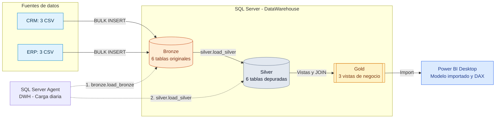
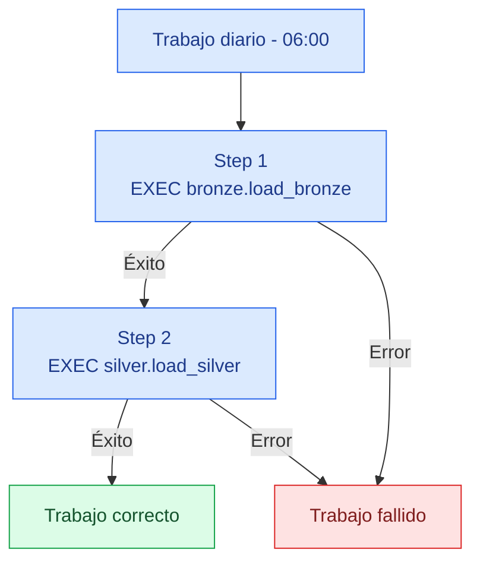

# Arquitectura del Data Warehouse — CicloNova

## 1. Objetivo

Integrar información de un **CRM** y un **ERP** en un Data Warehouse de SQL Server para analizar ventas, clientes y productos con Power BI. La solución sigue una arquitectura **Medallion (Bronze → Silver → Gold)**.

> **Implementación realizada:** SQL Server local (`localhost`), base de datos `DataWarehouse`, cargas con T-SQL y programación mediante SQL Server Agent. La capa Gold se expone mediante **vistas**, no mediante tablas materializadas.

## 2. Vista general

**Interpretación:** el trabajo de SQL Server Agent recarga Bronze y luego Silver. Las vistas Gold consultan los datos Silver; no requieren un tercer paso de inserción.

## 3. Componentes

| Componente | Implementación | Responsabilidad |
|---|---|---|
| Fuentes | `source_crm/` y `source_erp/` | Seis CSV del CRM y ERP |
| Bronze | Esquema `bronze` (6 tablas) | Conservar los datos de origen cargados mediante `BULK INSERT` |
| Silver | Esquema `silver` (6 tablas) | Limpiar, normalizar y comprobar calidad |
| Gold | Esquema `gold` (3 vistas) | Presentar dimensiones y hechos analíticos |
| Orquestación | SQL Server Agent | Ejecutar los dos procedimientos en secuencia |
| Consumo | Power BI Desktop | Importar las tres vistas, crear medidas DAX e informe interactivo |

### 3.1 Capa Bronze

Tablas:

- `bronze.crm_cust_info`
- `bronze.crm_prd_info`
- `bronze.crm_sales_details`
- `bronze.erp_cust_az12`
- `bronze.erp_loc_a101`
- `bronze.erp_px_cat_g1v2`

Scripts: [`../scripts/bronze/ddl_bronze.sql`](../scripts/bronze/ddl_bronze.sql) y [`../scripts/bronze/proc_load_bronze.sql`](../scripts/bronze/proc_load_bronze.sql).

### 3.2 Capa Silver

Conserva las seis entidades, con nombres equivalentes en el esquema `silver`. Algunas transformaciones aplicadas:

- Clientes CRM: eliminación de espacios, normalización de estado civil y género.
- Productos CRM: separación de claves de categoría/producto, tratamiento de costes y fechas de vigencia.
- Ventas CRM: conversión de fechas y corrección de importes/precios incoherentes.
- Datos demográficos ERP: normalización de identificadores, género y fechas de nacimiento futuras.
- País ERP: normalización de códigos de país y valores desconocidos.
- Categorías ERP: carga y comprobación de correspondencias.

Scripts: [`../scripts/silver/ddl_silver.sql`](../scripts/silver/ddl_silver.sql) y [`../scripts/silver/proc_load_silver.sql`](../scripts/silver/proc_load_silver.sql).

### 3.3 Capa Gold

El script [`../scripts/gold/ddl_gold.sql`](../scripts/gold/ddl_gold.sql) define las vistas:

| Vista | Grano | Registros comprobados |
|---|---|---:|
| `gold.dim_customers` | Un cliente | 18.484 |
| `gold.dim_products` | Un producto vigente | 295 |
| `gold.fact_sales` | Una línea de venta | 60.398 |

`fact_sales` contiene `customer_key` y `product_key` para relacionarse con ambas dimensiones. En Power BI se validaron dos relaciones **muchos a uno (`*:1`)**, activas y con filtro unidireccional desde la dimensión hacia los hechos.

Las claves subrogadas se generan en las vistas mediante `ROW_NUMBER()`. No son claves persistidas físicamente; si cambia la ordenación o el conjunto de filas, pueden cambiar sus valores. En el modelo actual se regeneran de forma consistente al consultar las vistas.

## 4. Carga y orquestación

El trabajo **`DWH - Carga diaria`** está configurado en SQL Server Agent con esta secuencia:

La gestión de errores de ambos procedimientos utiliza `TRY...CATCH` y `THROW` para que SQL Server Agent pueda identificar los fallos.

**Prueba realizada:** ejecución manual del trabajo con `sp_start_job` y revisión del historial de `msdb`: ambos pasos y el resultado global se registraron como correctos.

Script: [`../scripts/automation/job_carga_diaria.sql`](../scripts/automation/job_carga_diaria.sql).

> La programación depende de que SQL Server y el servicio SQL Server Agent estén encendidos en la máquina virtual a la hora prevista.

## 5. Calidad de datos

Los controles se encuentran en:

- [`../tests/quality_checks_silver.sql`](../tests/quality_checks_silver.sql)
- [`../tests/quality_checks_gold.sql`](../tests/quality_checks_gold.sql)

Entre los resultados comprobados figuran: ausencia de duplicados en claves de las dimensiones; **19** fechas de pedido nulas tras limpieza; **0** importes incoherentes en Gold; y **7** productos de categoría `CO_PE` sin correspondencia en el ERP. Estas excepciones conocidas no deben ocultarse en el seguimiento de calidad.

## 6. Consumo analítico

Power BI Desktop se conecta a `localhost` / `DataWarehouse` en modo **Import**. Se importaron las tres vistas Gold y se construyeron indicadores DAX, gráficos y segmentadores.

| Indicador global | Resultado comprobado |
|---|---:|
| Ventas totales | 29.356.250 |
| Unidades vendidas | 60.423 |
| Pedidos distintos | 27.659 |
| Clientes con compras | 18.484 |
| Ticket medio por pedido | 1.061,36 |

El archivo del informe es [`../powerbi/CicloNova_Dashboard.pbix`](../powerbi/CicloNova_Dashboard.pbix).

## 7. Limitaciones y consideraciones

- El proceso Bronze/Silver realiza cargas completas; no se ha implantado actualización incremental.
- La capa Gold está definida mediante vistas; sus resultados dependen del estado actual de Silver.
- Las 19 fechas de pedido nulas afectan a la serie por año, pero no al total general de ventas.
- Los períodos de 2010 y 2014 son parciales y no deben compararse directamente con años completos.
- El dashboard puede ocultar categorías desconocidas (`n/a`) **solo a nivel de visualización**, sin alterar la información almacenada.
- Las programaciones y conexiones locales dependen de la máquina virtual.

## 8. Documentación relacionada

- [Linaje de datos](data_lineage.md)
- [Modelo dimensional](data_model.md)
- [Catálogo de datos](data_catalog.md)
- [Convenciones](naming_conventions.md)
- [README principal](../README.md)
