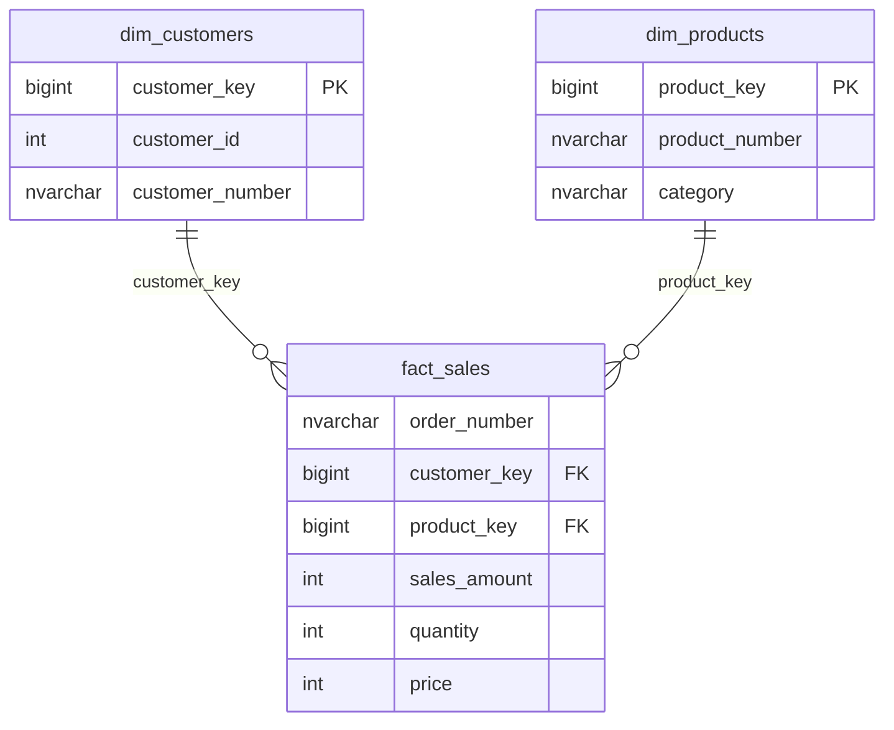

# Catálogo de datos — CicloNova

## 1. Propósito y alcance

Este catálogo describe las **30 columnas de las tres vistas** de la capa **Gold** de la base de datos `DataWarehouse`: `gold.dim_customers` (10), `gold.dim_products` (11) y `gold.fact_sales` (9). Las vistas integran y exponen datos transformados en la capa Silver para análisis en Power BI.

**Fuentes de definición:** [`../scripts/gold/ddl_gold.sql`](../scripts/gold/ddl_gold.sql), [`data_model.md`](data_model.md) y las definiciones de las tablas Silver. Los ejemplos son **ilustrativos**, salvo los valores categóricos y resultados que se comprobaron durante el proyecto; no pretenden identificar registros concretos.

> **Nota de tipos:** `ROW_NUMBER()` devuelve `BIGINT` en SQL Server, aunque los diagramas simplificados representen las claves subrogadas como enteros `INT`. Los campos de texto proceden de columnas `NVARCHAR(50)` de Silver y las fechas de columnas `DATE`. Estos tipos son derivados de la definición SQL; para inspeccionar los tipos exactos del servidor se puede ejecutar `sp_describe_first_result_set` sobre cada vista.

## 2. Vista `gold.dim_customers`

**Propósito:** unificar en una fila por cliente los datos del CRM con país, nacimiento y género complementarios del ERP. **Filas validadas:** 18.484.

| Columna | Tipo SQL | Descripción de negocio | Ejemplo ilustrativo | Origen en Silver / regla |
|---|---|---|---|---|
| `customer_key` | `BIGINT` | Clave subrogada lógica de cliente | `1` | `ROW_NUMBER() OVER (ORDER BY ci.cst_id)` |
| `customer_id` | `INT` | Identificador numérico de cliente en CRM | `11000` | `crm_cust_info.cst_id` |
| `customer_number` | `NVARCHAR(50)` | Código alfanumérico de cliente para integrar sistemas | `AW00011000` | `crm_cust_info.cst_key` |
| `first_name` | `NVARCHAR(50)` | Nombre del cliente, sin espacios sobrantes | `Marc` | `crm_cust_info.cst_firstname` |
| `last_name` | `NVARCHAR(50)` | Apellido del cliente | `Navarro` | `crm_cust_info.cst_lastname` |
| `country` | `NVARCHAR(50)` | País de residencia normalizado | `Australia` | `erp_loc_a101.cntry` mediante `cst_key = cid` |
| `marital_status` | `NVARCHAR(50)` | Estado civil normalizado | `Married` | `crm_cust_info.cst_marital_status` |
| `gender` | `NVARCHAR(50)` | Género consolidado; prioridad del CRM | `Female` | Si `ci.cst_gndr != 'n/a'`, CRM; si no, `COALESCE(erp_cust_az12.gen, 'n/a')` |
| `birthdate` | `DATE` | Fecha de nacimiento depurada | `1985-06-15` | `erp_cust_az12.bdate` |
| `create_date` | `DATE` | Fecha de alta del cliente en CRM | `2012-05-10` | `crm_cust_info.cst_create_date` |

**Integración:** `LEFT JOIN` del CRM con `silver.erp_cust_az12` y `silver.erp_loc_a101` por la clave de cliente normalizada. El género desconocido se redujo de 4.569 valores `n/a` en CRM a **15** en Gold (9.341 `Male`, 9.128 `Female`, 15 `n/a`).

## 3. Vista `gold.dim_products`

**Propósito:** proporcionar una fila por versión **vigente** de producto con sus descripciones CRM y clasificación ERP. **Filas validadas:** 295.

| Columna | Tipo SQL | Descripción de negocio | Ejemplo ilustrativo | Origen en Silver / regla |
|---|---|---|---|---|
| `product_key` | `BIGINT` | Clave subrogada lógica de producto | `1` | `ROW_NUMBER() OVER (ORDER BY pn.prd_start_dt, pn.prd_key)` |
| `product_id` | `INT` | Identificador interno CRM | `101` | `crm_prd_info.prd_id` |
| `product_number` | `NVARCHAR(50)` | Código de producto sin prefijo de categoría | `HL-U509-R` | `crm_prd_info.prd_key` |
| `product_name` | `NVARCHAR(50)` | Nombre comercial | `Mountain-200 Black-46` | `crm_prd_info.prd_nm` |
| `category_id` | `NVARCHAR(50)` | Código de categoría normalizado | `CO_PE` | `crm_prd_info.cat_id` |
| `category` | `NVARCHAR(50)` | Categoría comercial del ERP | `Bikes` | `erp_px_cat_g1v2.cat` |
| `subcategory` | `NVARCHAR(50)` | Subcategoría comercial | `Mountain Bikes` | `erp_px_cat_g1v2.subcat` |
| `maintenance` | `NVARCHAR(50)` | Indica mantenimiento requerido según ERP | `Yes` | `erp_px_cat_g1v2.maintenance` |
| `cost` | `INT` | Coste depurado del producto | `350` | `crm_prd_info.prd_cost` |
| `product_line` | `NVARCHAR(50)` | Línea de producto estandarizada | `Mountain` | `crm_prd_info.prd_line` |
| `start_date` | `DATE` | Inicio de vigencia de la versión actual | `2013-01-01` | `crm_prd_info.prd_start_dt` |

**Selección de la versión actual:** `WHERE pn.prd_end_dt IS NULL`. Se relaciona con `silver.erp_px_cat_g1v2` por `pn.cat_id = pc.id` mediante `LEFT JOIN`.

**Incidencia conocida:** siete productos de pedales con `category_id = 'CO_PE'` carecen de clasificación equivalente en el catálogo ERP. Sus campos `category`, `subcategory` y `maintenance` pueden ser `NULL`. No se eliminan los productos.

## 4. Vista `gold.fact_sales`

**Propósito:** conservar una fila por **línea de pedido**, con claves de dimensiones y métricas analíticas. **Filas validadas:** 60.398.

| Columna | Tipo SQL | Descripción de negocio | Ejemplo ilustrativo | Origen en Silver / regla |
|---|---|---|---|---|
| `order_number` | `NVARCHAR(50)` | Identificador del pedido; puede repetirse en varias líneas | `SO000001` | `crm_sales_details.sls_ord_num` |
| `product_key` | `BIGINT` | Clave para vincular la venta a la dimensión producto | `1` | `gold.dim_products.product_key`, unión por `sls_prd_key = product_number` |
| `customer_key` | `BIGINT` | Clave para vincular la venta a la dimensión cliente | `1` | `gold.dim_customers.customer_key`, unión por `sls_cust_id = customer_id` |
| `order_date` | `DATE` | Fecha del pedido (admite nulos depurados) | `2013-06-01` | `crm_sales_details.sls_order_dt` |
| `shipping_date` | `DATE` | Fecha de envío | `2013-06-05` | `crm_sales_details.sls_ship_dt` |
| `due_date` | `DATE` | Fecha límite o de vencimiento | `2013-06-12` | `crm_sales_details.sls_due_dt` |
| `sales_amount` | `INT` | Importe total de la línea de venta | `1000` | `crm_sales_details.sls_sales` |
| `quantity` | `INT` | Unidades vendidas en la línea | `2` | `crm_sales_details.sls_quantity` |
| `price` | `INT` | Precio unitario depurado | `500` | `crm_sales_details.sls_price` |

**Reglas validadas:** las ventas cumplen `sales_amount = quantity * price`; se detectaron **0 líneas incoherentes** en Gold. Existen **19 ventas sin `order_date`**, que se mantienen en el total de ventas y no aparecen al agrupar por año.

## 5. Relaciones y granularidad

Las dos relaciones se configuraron en Power BI como **uno a varios (1:*)**, activas y con filtro unidireccional de dimensión a hechos. Las etiquetas PK/FK del esquema son **lógicas**: las vistas SQL no declaran restricciones físicas.

> **Precaución:** las claves generadas con `ROW_NUMBER()` se recalculan. En un DWH productivo convendrían claves persistentes y gestión histórica explícita.

## 6. Indicadores de negocio y medidas DAX

| Indicador | Definición sobre Gold | Resultado global validado |
|---|---|---:|
| Ventas Totales | `SUM(fact_sales[sales_amount])` | 29.356.250 |
| Unidades Vendidas | `SUM(fact_sales[quantity])` | 60.423 |
| Pedidos | `DISTINCTCOUNT(fact_sales[order_number])` | 27.659 |
| Clientes con Compras | `DISTINCTCOUNT(fact_sales[customer_key])` | 18.484 |
| Ticket Medio | Ventas Totales / Pedidos | 1.061,36 |

Los nombres de tabla en DAX deben corresponder a los del modelo de Power BI (por ejemplo, `'gold fact_sales'`). Las medidas y los gráficos se documentan con más detalle en [`data_model.md`](data_model.md) y el [`README`](../README.md).

## 7. Notas de calidad y alcance

- **Integración del género:** el CRM tiene prioridad; el ERP cubre valores desconocidos.
- **Categorías ERP:** `CO_PE` no existe en el catálogo; afecta a 7 productos vigentes.
- **Análisis temporal:** 2010 y 2014 son períodos parciales. Las 19 ventas sin fecha no se asignan a un año.
- **Modelo lógico:** Gold contiene vistas; la actualización se realiza recargando Bronze y Silver mediante SQL Server Agent.
- **Ejemplos:** los identificadores, nombres y fechas de muestra son orientativos, no prueba de existencia de esas filas específicas.

## 8. Documentación relacionada

- [Arquitectura](architecture.md)
- [Linaje de datos](data_lineage.md)
- [Modelo dimensional](data_model.md)
- [Convenciones de nomenclatura](naming_conventions.md)
- [DDL de Gold](../scripts/gold/ddl_gold.sql)
- [Controles de calidad de Gold](../tests/quality_checks_gold.sql)
