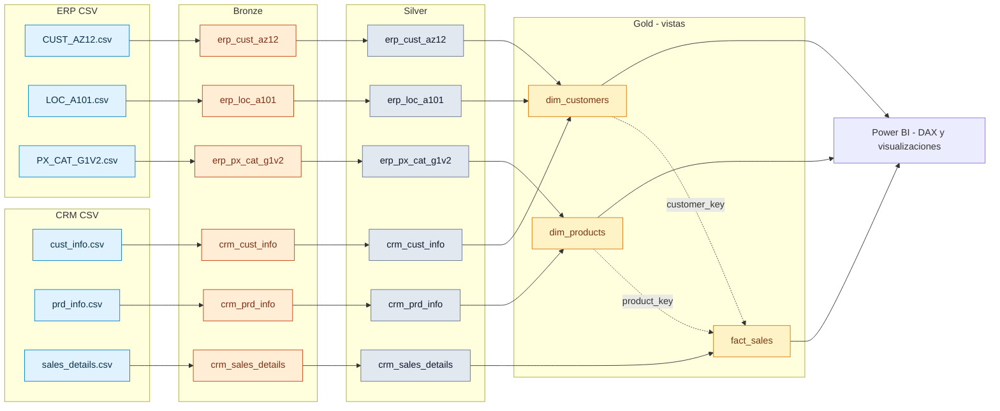
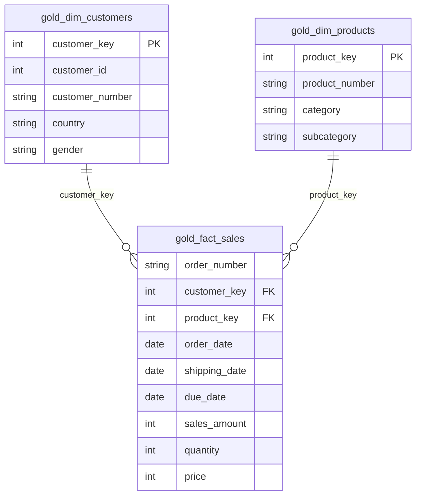

# Linaje de datos — CicloNova

## 1. Alcance

Este documento describe cómo las **seis fuentes CSV** de CRM y ERP llegan a las tablas Bronze, se normalizan en Silver y se combinan en las **tres vistas Gold** consumidas por Power BI.

## 2. Linaje extremo a extremo

Las líneas discontinuas hacia `fact_sales` representan **relaciones lógicas del modelo dimensional**, no cargas de datos de las dimensiones hacia la tabla de hechos.

## 3. Inventario de fuentes

| Sistema | CSV | Tabla Bronze | Tabla Silver | Registros Silver validados |
|---|---|---|---|---:|
| CRM | `cust_info.csv` | `bronze.crm_cust_info` | `silver.crm_cust_info` | 18.484 |
| CRM | `prd_info.csv` | `bronze.crm_prd_info` | `silver.crm_prd_info` | 397 |
| CRM | `sales_details.csv` | `bronze.crm_sales_details` | `silver.crm_sales_details` | 60.398 |
| ERP | `CUST_AZ12.csv` | `bronze.erp_cust_az12` | `silver.erp_cust_az12` | 18.484 |
| ERP | `LOC_A101.csv` | `bronze.erp_loc_a101` | `silver.erp_loc_a101` | 18.484 |
| ERP | `PX_CAT_G1V2.csv` | `bronze.erp_px_cat_g1v2` | `silver.erp_px_cat_g1v2` | 37 |

Los recuentos pertenecen a **Silver**; no deben interpretarse automáticamente como recuentos originales de cada CSV.

## 4. Transformaciones de Bronze a Silver

| Entidad | Transformaciones relevantes |
|---|---|
| `crm_cust_info` | `TRIM` de nombres; normalización de estado civil y género |
| `crm_prd_info` | Separar `prd_key` en categoría y producto; valores por defecto de coste; normalización de línea; fechas de vigencia calculadas con `LEAD` |
| `crm_sales_details` | Convertir fechas enteras a `DATE`; fechas inválidas a `NULL`; normalizar ventas, cantidad y precio |
| `erp_cust_az12` | Quitar prefijo `NAS` de `cid`; fechas futuras a `NULL`; género normalizado |
| `erp_loc_a101` | Quitar guiones de `cid`; `DE` a `Germany` y `US`/`USA` a `United States`; vacíos a `n/a` |
| `erp_px_cat_g1v2` | Carga de categorías, subcategorías y mantenimiento, tras comprobar su calidad |

La implementación concreta está en [`../scripts/silver/proc_load_silver.sql`](../scripts/silver/proc_load_silver.sql).

## 5. Integración Silver a Gold

### 5.1 `gold.dim_customers`

**Fuentes:**

- `silver.crm_cust_info` (identificación, nombre, estado civil, género y alta)
- `silver.erp_cust_az12` (fecha de nacimiento y género de respaldo)
- `silver.erp_loc_a101` (país)

**Enlaces:** `crm_cust_info.cst_key` con `erp_cust_az12.cid` y `erp_loc_a101.cid`, una vez normalizados los identificadores.

**Regla destacada:** se prioriza el género CRM salvo cuando es `n/a`, en cuyo caso se consulta el ERP. `customer_key` es una clave subrogada generada por la vista.

**Resultado validado:** 18.484 clientes.

### 5.2 `gold.dim_products`

**Fuentes:**

- `silver.crm_prd_info` (producto, coste, línea, fechas y categoría identificadora)
- `silver.erp_px_cat_g1v2` (categoría, subcategoría y mantenimiento)

**Enlace:** `crm_prd_info.cat_id = erp_px_cat_g1v2.id`. La vista conserva solo versiones de producto con `prd_end_dt IS NULL`.

**Resultado validado:** 295 productos vigentes. Los siete pedales con `cat_id = CO_PE` no tienen correspondencia en el catálogo ERP, por lo que sus campos de categoría pueden ser `NULL`.

### 5.3 `gold.fact_sales`

**Fuente principal:** `silver.crm_sales_details`.

**Relaciones de búsqueda:**

- `sls_cust_id = gold.dim_customers.customer_id` para obtener `customer_key`.
- `sls_prd_key = gold.dim_products.product_number` para obtener `product_key`.

La vista conserva las fechas de pedido, envío y vencimiento, además de ventas, cantidad y precio. **Grano:** una línea de pedido.

**Resultado validado:** 60.398 líneas de venta, igual que en Silver.

## 6. Modelo dimensional y consumo

En Power BI se comprobaron las dos relaciones activas de `fact_sales` hacia las dimensiones, ambas **muchos a uno**, con **dirección única de filtro** desde las dimensiones.

## 7. Linaje de indicadores DAX

| Medida Power BI | Columnas Gold de origen | Cálculo |
|---|---|---|
| Ventas Totales | `fact_sales.sales_amount` | `SUM` |
| Unidades Vendidas | `fact_sales.quantity` | `SUM` |
| Pedidos | `fact_sales.order_number` | `DISTINCTCOUNT` |
| Clientes con Compras | `fact_sales.customer_key` | `DISTINCTCOUNT` |
| Ticket Medio | Medidas Ventas Totales y Pedidos | `DIVIDE([Ventas Totales], [Pedidos], 0)` |

El informe está disponible en [`../powerbi/CicloNova_Dashboard.pbix`](../powerbi/CicloNova_Dashboard.pbix).

## 8. Reglas de calidad y excepciones conocidas

- **19** ventas conservan la fecha de pedido `NULL` tras detectar fechas inválidas. No aparecen en agrupaciones anuales por fecha, pero sí en el total global.
- Se comprobaron **0** líneas con importes incoherentes en Gold.
- **7** productos vigentes de categoría `CO_PE` carecen de correspondencia en el catálogo ERP.
- Valores como `n/a` se conservan en los datos; algunos gráficos los ocultan mediante filtros del visual.
- **2010 y 2014** representan períodos parciales.

## 9. Documentos relacionados

- [Arquitectura del Data Warehouse](architecture.md)
- [Modelo de datos](data_model.md)
- [Catálogo de datos](data_catalog.md)
- [README principal](../README.md)
