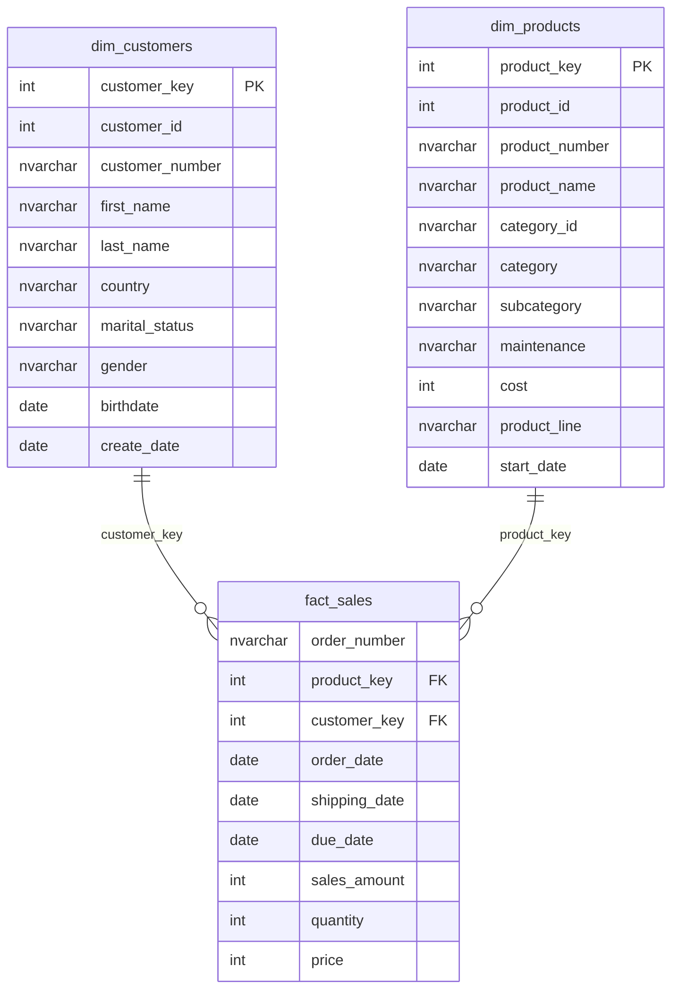

# Modelo de datos dimensional — CicloNova

## 1. Objetivo y alcance

La capa **Gold** de `DataWarehouse` presenta un **modelo en estrella** para analizar ventas, clientes y productos. Combina información depurada del CRM y del ERP mediante **tres vistas SQL Server** definidas en [`../scripts/gold/ddl_gold.sql`](../scripts/gold/ddl_gold.sql).

> **Importante:** `gold.dim_customers`, `gold.dim_products` y `gold.fact_sales` son **vistas**, no tablas físicas. Sus claves y relaciones son **lógicas**: la base de datos no impone restricciones `PRIMARY KEY` o `FOREIGN KEY` sobre estas vistas. Las relaciones se han configurado y comprobado en Power BI Desktop.

## 2. Diagrama del modelo en estrella



**Lectura del diagrama:** una fila de `dim_customers` puede relacionarse con múltiples líneas de `fact_sales`; lo mismo ocurre con `dim_products`. Las etiquetas `PK` y `FK` describen **papeles analíticos**, no restricciones físicas declaradas en SQL Server.

## 3. Tablas de dimensiones y hechos

| Objeto Gold | Tipo | Granularidad (grano) | Filas verificadas |
|---|---|---|---:|
| `gold.dim_customers` | Dimensión | Una fila por cliente | 18.484 |
| `gold.dim_products` | Dimensión | Una fila por producto **vigente** | 295 |
| `gold.fact_sales` | Hechos | Una línea de venta del CRM | 60.398 |

### 3.1 Dimensión `gold.dim_customers`

Integra tres tablas Silver:

- `silver.crm_cust_info`: identificadores, nombres, estado civil, género CRM y fecha de alta.
- `silver.erp_cust_az12`: fecha de nacimiento y género ERP de respaldo.
- `silver.erp_loc_a101`: país del cliente.

Las tablas del ERP se relacionan con el cliente mediante los identificadores previamente normalizados (`cst_key = cid`). Si el género de CRM es `n/a`, la vista utiliza el valor disponible del ERP.

| Columna | Descripción |
|---|---|
| `customer_key` | Clave subrogada lógica de la dimensión |
| `customer_id` | Identificador numérico del CRM; sirve para buscar la clave en ventas |
| `customer_number` | Identificador alfanumérico del cliente |
| `first_name`, `last_name` | Nombre y apellidos |
| `country` | País normalizado a partir del ERP |
| `marital_status` | Estado civil normalizado |
| `gender` | Género consolidado CRM/ERP |
| `birthdate` | Fecha de nacimiento del ERP |
| `create_date` | Fecha de alta del CRM |

**Comprobación:** 18.484 clientes; 9.341 `Male`, 9.128 `Female` y 15 `n/a`.

### 3.2 Dimensión `gold.dim_products`

Integra `silver.crm_prd_info` con `silver.erp_px_cat_g1v2`, mediante `cat_id = id`. Solo conserva la versión vigente del producto:

```sql
WHERE pn.prd_end_dt IS NULL
```

| Columna | Descripción |
|---|---|
| `product_key` | Clave subrogada lógica de la dimensión |
| `product_id` | Identificador interno del producto en CRM |
| `product_number` | Clave de negocio del producto, usada desde ventas |
| `product_name` | Denominación comercial |
| `category_id` | Código de categoría derivado de CRM |
| `category`, `subcategory` | Clasificación enriquecida desde el ERP |
| `maintenance` | Requiere mantenimiento, según ERP |
| `cost` | Coste del producto del CRM, depurado en Silver |
| `product_line` | Línea de producto normalizada |
| `start_date` | Fecha de inicio de la versión vigente |

**Comprobación:** 295 productos vigentes. Hay **7 pedales** con `category_id = CO_PE` sin correspondencia en el ERP: `category` y `subcategory` pueden quedar en `NULL`. Es una incidencia de calidad **conocida**, no un error de relación con las ventas.

### 3.3 Hechos `gold.fact_sales`

Se alimenta de `silver.crm_sales_details` y busca las claves de las dimensiones a través de dos uniones:

```sql
FROM silver.crm_sales_details sd
LEFT JOIN gold.dim_products pr
    ON sd.sls_prd_key = pr.product_number
LEFT JOIN gold.dim_customers cu
    ON sd.sls_cust_id = cu.customer_id
```

| Columna | Descripción |
|---|---|
| `order_number` | Número de pedido; **no es una clave única** de la vista |
| `product_key` | Clave lógica para enlazar con `dim_products` |
| `customer_key` | Clave lógica para enlazar con `dim_customers` |
| `order_date` | Fecha del pedido |
| `shipping_date` | Fecha de envío |
| `due_date` | Fecha de vencimiento |
| `sales_amount` | Importe de venta depurado |
| `quantity` | Cantidad vendida |
| `price` | Precio unitario depurado |

**Grano:** cada fila representa una línea de venta. Un pedido puede comprender varias líneas; por eso **Pedidos** utiliza `DISTINCTCOUNT(order_number)` y no `COUNTROWS`.

**Comprobaciones:** 60.398 líneas; 19 fechas de pedido nulas tras depuración; 0 líneas con ventas nulas/no positivas o incoherentes con `quantity * price`.

## 4. Claves subrogadas y relaciones

Las vistas de dimensiones generan las claves subrogadas utilizando `ROW_NUMBER()`:

```sql
-- En gold.dim_customers
ROW_NUMBER() OVER (ORDER BY cst_id) AS customer_key

-- En gold.dim_products
ROW_NUMBER() OVER (ORDER BY pn.prd_start_dt, pn.prd_key) AS product_key
```

Esta técnica permite relacionar las vistas en el modelo actual. **Limitación:** las claves se calculan al consultar las vistas y pueden variar tras cambios en los datos o en el orden; no equivalen a identificadores persistentes de un Data Warehouse productivo.

| Tabla en el lado «1» | Tabla en el lado «*» | Campo | Filtro cruzado | Estado |
|---|---|---|---|---|
| `gold.dim_customers` | `gold.fact_sales` | `customer_key` | Único, dimensión → hechos | Activa |
| `gold.dim_products` | `gold.fact_sales` | `product_key` | Único, dimensión → hechos | Activa |

En Power BI, al editar las relaciones desde la tabla de hechos, la cardinalidad aparece como **muchos a uno (`*:1`)**, equivalente a **uno a muchos (`1:*`)** desde la dimensión.

> La relación unidireccional explica por qué filtros de Año o Categoría afectan a las medidas de ventas, pero **no tienen por qué filtrar un gráfico basado solo en atributos de `dim_customers`**, como el perfil demográfico.

## 5. Modelo en Power BI

Conexión SQL Server: `localhost` → base de datos `DataWarehouse` → **Import** de las tres vistas Gold.

### Medidas DAX implementadas

Las tablas aparecen en Power BI con nombres tales como `'gold fact_sales'` (espacio entre esquema y objeto), aunque en SQL Server se llaman `gold.fact_sales`.

```dax
Ventas Totales =
SUM('gold fact_sales'[sales_amount])
```

```dax
Unidades Vendidas =
SUM('gold fact_sales'[quantity])
```

```dax
Pedidos =
DISTINCTCOUNT('gold fact_sales'[order_number])
```

```dax
Clientes con Compras =
DISTINCTCOUNT('gold fact_sales'[customer_key])
```

```dax
Ticket Medio =
DIVIDE([Ventas Totales], [Pedidos], 0)
```

### Indicadores sin filtros

| Medida | Resultado validado |
|---|---:|
| Ventas Totales | 29.356.250 |
| Unidades Vendidas | 60.423 |
| Pedidos | 27.659 |
| Clientes con Compras | 18.484 |
| Ticket Medio | 1.061,36 |

El informe incluye ventas por categoría y país, evolución anual, Top 5 productos, perfil de clientes, ticket medio por país y segmentadores de Año, País y Categoría.

## 6. Particularidades de calidad e interpretación

1. **Productos vigentes:** el catálogo Gold filtra por `prd_end_dt IS NULL`; el histórico permanece en Silver.
2. **Categorías pendientes:** los 7 productos `CO_PE` no reciben descripción ERP de categoría; debe documentarse su falta de correspondencia.
3. **Fechas ausentes:** 19 líneas de venta carecen de fecha de pedido válida. El gráfico por año no las presenta en los años 2010–2014, aunque forman parte de los indicadores generales.
4. **Años parciales:** 2010 y 2014 no son ejercicios completos; no corresponde comparar su volumen directamente con años completos.
5. **Filtros visuales:** los valores `n/a` pueden ocultarse en gráficos concretos por claridad, sin eliminar sus registros de la dimensión o de las medidas globales.
6. **No hay dimensión de fechas independiente:** la evolución anual utiliza la jerarquía de `order_date` en Power BI. Una `dim_date` sería una ampliación futura, no parte de las tres vistas Gold implementadas.

## 7. Referencias del repositorio

- [Arquitectura Medallion](architecture.md)
- [Linaje de datos](data_lineage.md)
- [DDL de las vistas Gold](../scripts/gold/ddl_gold.sql)
- [Pruebas de calidad Gold](../tests/quality_checks_gold.sql)
- [Catálogo de datos](data_catalog.md)
- [Dashboard Power BI](../powerbi/CicloNova_Dashboard.pbix)

---

**Estado:** modelo Gold creado y validado en SQL Server; tres vistas importadas y dos relaciones verificadas en Power BI Desktop.
