# CicloNova — Memoria de desarrollo

**Proyecto final de Data Engineering y Business Intelligence**  
**Tecnologías:** SQL Server · T-SQL · SQL Server Agent · Power BI Desktop · GitHub  
**Entorno:** máquina virtual Windows, instancia SQL Server `localhost`, base de datos `DataWarehouse`  
**Periodo documentado:** octubre de 2026

> **Propósito de esta memoria.** Registrar el orden de construcción del proyecto, las decisiones técnicas, las comprobaciones y las incidencias resueltas. No sustituye al [README principal](../README.md), que presenta los resultados, ni a la [documentación de arquitectura](architecture.md) y al [catálogo de datos](data_catalog.md), que describen el diseño final.
>
> Los resultados numéricos se refieren a las ejecuciones verificadas durante la práctica. El proyecto es formativo y utiliza datos de ejemplo.

## 1. Resumen del trabajo realizado

Se construyó un Data Warehouse a partir de seis archivos CSV procedentes de dos sistemas ficticios, CRM y ERP. El desarrollo siguió la arquitectura **Bronze → Silver → Gold**, terminó con un **modelo dimensional en estrella** y se amplió con una carga automatizada y un dashboard de Power BI.

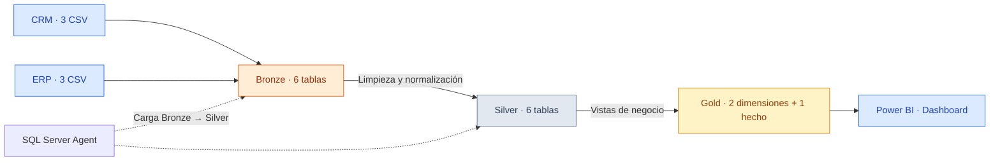

**Decisión de diseño:** Bronze y Silver se implementaron con tablas físicas; Gold se implementó mediante **vistas SQL**, por lo que no existe una tercera carga materializada para Gold.

## 2. Preparación del entorno y repositorio

1. Se trabajó en SQL Server desde SSMS sobre la instancia local `localhost`.
2. Se creó la base `DataWarehouse` y se organizaron los esquemas `bronze`, `silver` y `gold`.
3. Se distribuyeron los CSV en las carpetas de origen `datasets/source_crm/` y `datasets/source_erp/`.
4. Se organizó el código en `scripts/bronze/`, `scripts/silver/`, `scripts/gold/` y las validaciones en `tests/`.
5. El repositorio incorporó posteriormente `scripts/automation/`, `powerbi/`, `presentation/` e `images/` para los entregables y evidencias.

**Evidencias de preparación:**

- [Creación de DataWarehouse](../images/bronze/F007_001_Creacion_Tablas_Bronze.JPG) — evidencia de construcción de tablas Bronze.
- [Scripts SQL](../scripts/) y [pruebas](../tests/).

> **Nota:** la instancia SQL Server y las rutas que utiliza `BULK INSERT` pertenecen al equipo de desarrollo. Para reproducir una carga en otro ordenador deben ajustarse las rutas y permisos correspondientes.

## 3. Inventario y carga inicial de los datos

| Sistema | Archivo | Filas de origen |
|---|---|---:|
| CRM | `cust_info.csv` | 18.494 |
| CRM | `prd_info.csv` | 397 |
| CRM | `sales_details.csv` | 60.398 |
| ERP | `CUST_AZ12.csv` | 18.484 |
| ERP | `LOC_A101.csv` | 18.484 |
| ERP | `PX_CAT_G1V2.csv` | 37 |

### 3.1. Construcción de Bronze

Se crearon seis tablas en `bronze` y se realizó la primera ingesta mediante **`BULK INSERT`**. Durante la primera carga CRM hubo que revisar/corregir la ejecución; las capturas del desarrollo reflejan tanto la primera prueba como la corrección. Posteriormente se centralizó la ingesta en el procedimiento `bronze.load_bronze`.

El procedimiento permite recargar los datos de los seis ficheros en las tablas Bronze. La validación final confirmó los seis volúmenes esperados.

```sql
EXEC bronze.load_bronze;

SELECT 'crm_cust_info' AS tabla, COUNT(*) AS filas FROM bronze.crm_cust_info
UNION ALL SELECT 'crm_prd_info', COUNT(*) FROM bronze.crm_prd_info
UNION ALL SELECT 'crm_sales_details', COUNT(*) FROM bronze.crm_sales_details
UNION ALL SELECT 'erp_cust_az12', COUNT(*) FROM bronze.erp_cust_az12
UNION ALL SELECT 'erp_loc_a101', COUNT(*) FROM bronze.erp_loc_a101
UNION ALL SELECT 'erp_px_cat_g1v2', COUNT(*) FROM bronze.erp_px_cat_g1v2;
```

**Resultado:** 18.494, 397, 60.398, 18.484, 18.484 y 37 filas, respectivamente.

**Referencias:** [DDL Bronze](../scripts/bronze/ddl_bronze.sql) · [Procedimiento de carga](../scripts/bronze/proc_load_bronze.sql).


## 4. Transformaciones y controles en Silver

Se crearon las seis tablas Silver y se construyó `silver.load_silver` para ejecutar las transformaciones sobre los datos de Bronze.

### 4.1. Clientes del CRM

- Revisión de registros repetidos por identificador y conservación de la versión seleccionada según la lógica de carga.
- Eliminación de espacios en nombres y apellidos.
- Normalización de estado civil (`Single`, `Married`, `n/a`) y género (`Male`, `Female`, `n/a`).
- Comprobación posterior de claves duplicadas o nulas.

**Resultado:** 18.484 clientes depurados; no se obtuvieron identificadores duplicados o nulos en la comprobación presentada.


### 4.2. Productos del CRM

- Análisis de claves y formatos de identificadores de producto.
- Revisión y transformación de las fechas de vigencia.
- Comprobación de productos vigentes frente a versiones históricas.

**Resultado:** 397 registros/versiones, 295 productos vigentes y 0 intervalos con fecha de fin anterior a la de inicio en la validación ejecutada.


### 4.3. Ventas del CRM

- Revisión de las fechas de pedido, envío y vencimiento.
- Detección y tratamiento de importes, precios y cantidades anómalos.
- Comprobación de la regla `sales_amount = quantity * price`.

**Resultado:** 60.398 líneas de venta; 19 fechas de pedido nulas; 0 importes incorrectos y 0 ventas incoherentes según las consultas de validación.

```sql
SELECT COUNT(*) AS fechas_nulas
FROM silver.crm_sales_details
WHERE sls_order_dt IS NULL;

SELECT COUNT(*) AS ventas_incoherentes
FROM silver.crm_sales_details
WHERE sls_sales != sls_quantity * sls_price;
```


### 4.4. Integración de fuentes ERP

Se trabajó con los datos complementarios de **clientes**, **ubicaciones** y **categorías**. Entre las comprobaciones realizadas figuran la normalización de identificadores y países, y la revisión de fechas, género y códigos de categoría.

**Resultado destacado:** los países quedaron normalizados y la comprobación de identificadores de ubicaciones con guiones devolvió **0**; se mantuvo `n/a` cuando el país no estaba determinado.


**Referencias:** [DDL Silver](../scripts/silver/ddl_silver.sql) · [Procedimiento de carga](../scripts/silver/proc_load_silver.sql) · [Controles Silver](../tests/quality_checks_silver.sql).

## 5. Construcción del modelo Gold

La capa Gold se diseñó como un **modelo en estrella**, definido mediante vistas SQL y consumido posteriormente por Power BI.

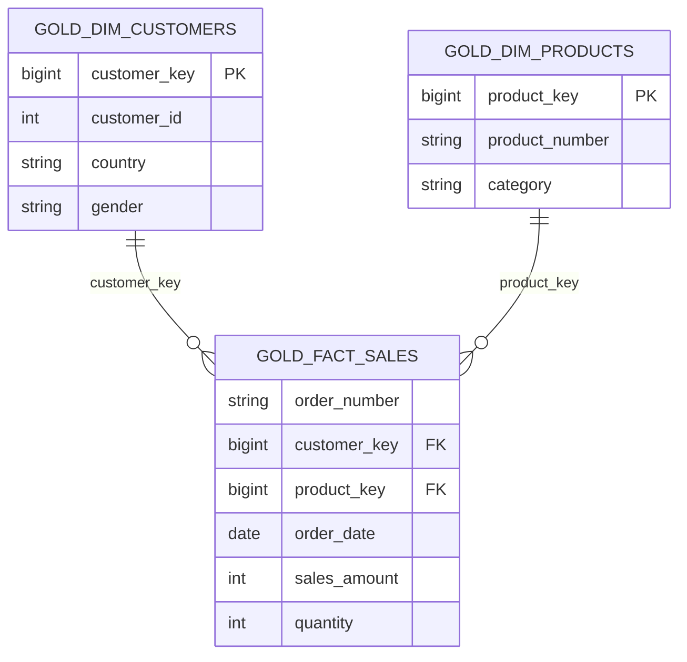

### 5.1. `gold.dim_customers`

Integra información de cliente del CRM y datos complementarios del ERP. La dimensión utiliza una **clave subrogada `customer_key`** y expone atributos analíticos como país, género y estado civil.

**Validación:** 18.484 filas; distribución por género: 9.341 `Male`, 9.128 `Female` y 15 `n/a`.

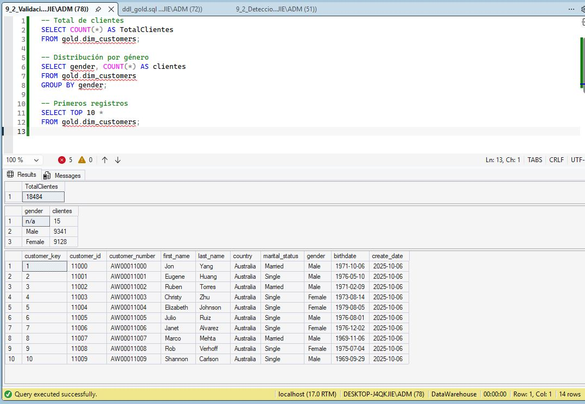

### 5.2. `gold.dim_products`

Expone los **295 productos vigentes** y combina sus atributos con las categorías del ERP. La integración detectó una limitación de origen: **siete pedales con `category_id = CO_PE` no tienen coincidencia en el catálogo ERP** y presentan categoría/subcategoría nulas. Se documentó el problema sin inventar valores.

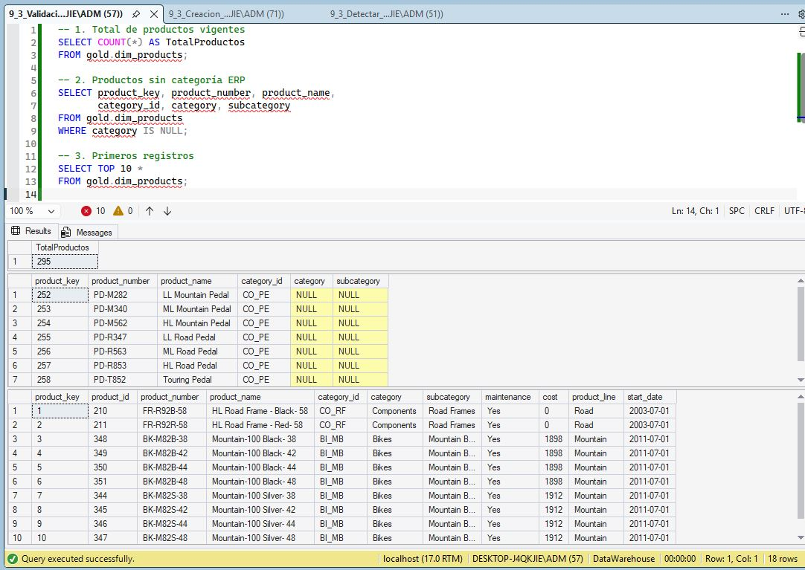

### 5.3. `gold.fact_sales`

Expone **una fila por línea de pedido**, vinculada a clientes y productos mediante `customer_key` y `product_key`; también incorpora las fechas y los valores comerciales. La definición emplea uniones desde las ventas Silver hacia las dimensiones Gold.

**Validación:** 60.398 filas. El recuento coincide con `silver.crm_sales_details`; esa igualdad de cantidades **no constituye, por sí sola, una prueba de igualdad fila a fila**.

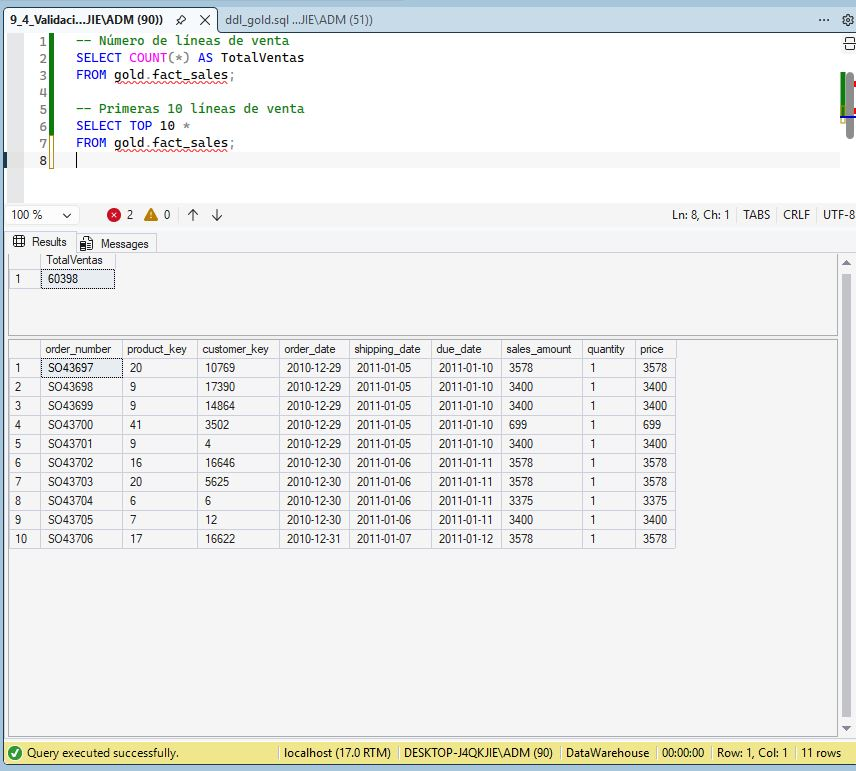

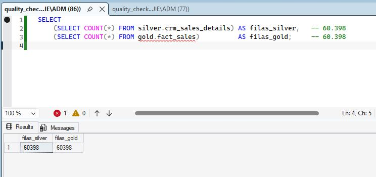

**Referencias:** [Definición de vistas Gold](../scripts/gold/ddl_gold.sql) · [Pruebas Gold](../tests/quality_checks_gold.sql) · [Modelo de datos](data_model.md) · [Catálogo Gold](data_catalog.md).

## 6. Automatización con SQL Server Agent

Finalizadas las cargas manuales y las comprobaciones, se construyó el trabajo **`DWH - Carga diaria`**, con dos pasos T-SQL:

1. `EXEC bronze.load_bronze;`
2. `EXEC silver.load_silver;`

La ejecución de Silver depende de que Bronze termine correctamente. Si alguno falla, el trabajo termina indicando error; los procedimientos se ajustaron para propagar excepciones con `THROW;`.

La programación quedó **habilitada todos los días a las 06:00**, siempre que la VM y los servicios SQL Server/SQL Server Agent estén activos.

**Prueba realizada:** el **24 de octubre de 2026** se verificó en el historial `msdb.dbo.sysjobhistory` una ejecución satisfactoria del trabajo y de ambos pasos. Esta prueba acredita la ejecución revisada; no implica que se hayan observado múltiples ejecuciones programadas.

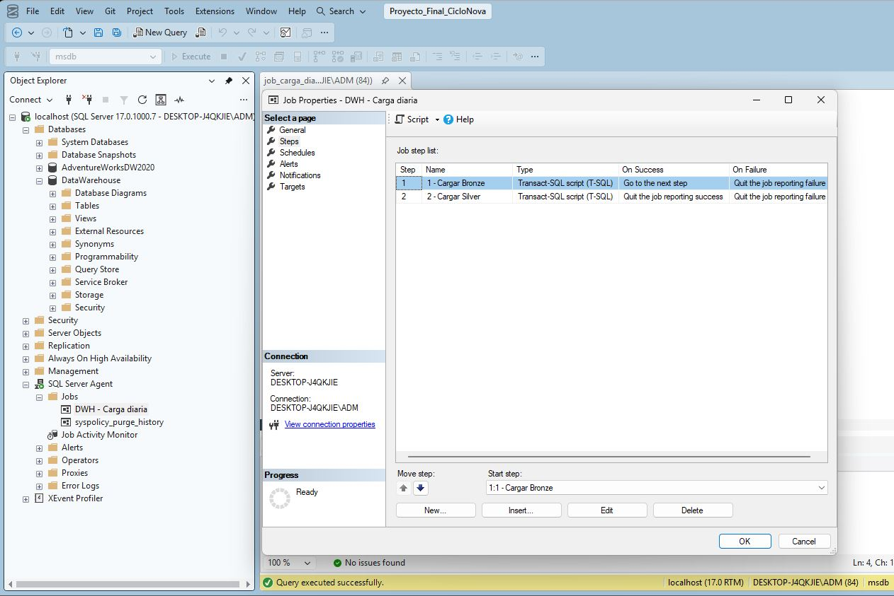

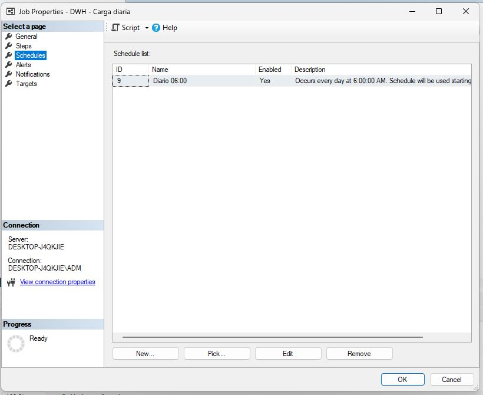

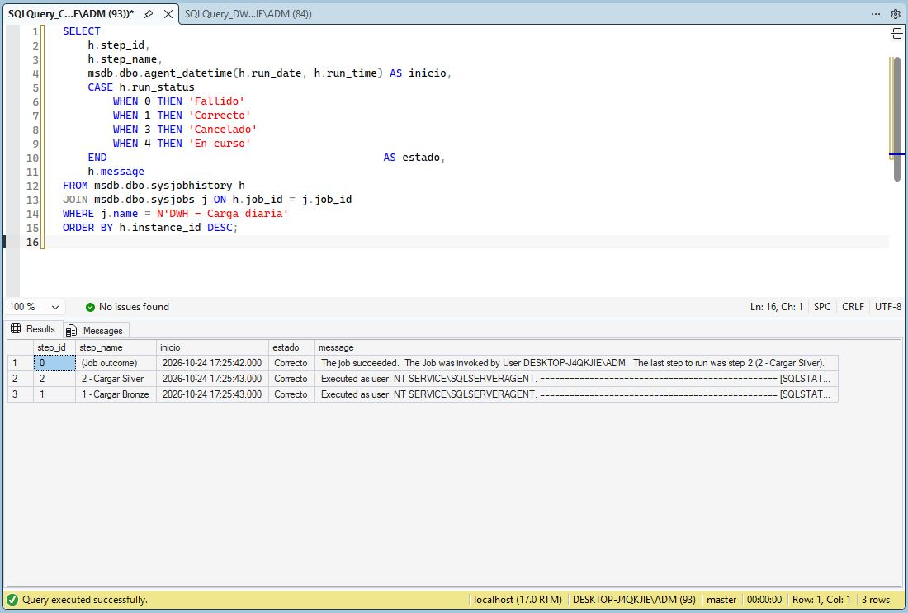

**Referencia:** [Script del trabajo](../scripts/automation/job_carga_diaria.sql).

## 7. Consultas de negocio y resultados

Se ejecutaron consultas SQL sobre las vistas Gold para contrastar los resultados antes de diseñar el dashboard.

| Indicador | Resultado |
|---|---:|
| Ventas totales | 29.356.250 |
| Unidades vendidas | 60.423 |
| Pedidos distintos | 27.659 |
| Clientes con compras | 18.484 |
| Ticket medio por pedido | 1.061,36 |

```sql
SELECT
    SUM(sales_amount) AS ventas_totales,
    SUM(quantity) AS unidades_vendidas,
    COUNT(DISTINCT order_number) AS pedidos,
    COUNT(DISTINCT customer_key) AS clientes_con_compras
FROM gold.fact_sales;
```

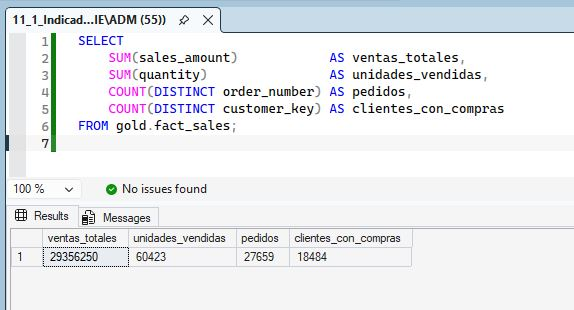

### 7.1. Hallazgos

- **Categorías:** Bikes 28.316.272 (96,46 %); Accessories 700.262 (2,39 %); Clothing 339.716 (1,16 %).
- **Países:** Estados Unidos 9.162.327 y Australia 9.060.172, los dos mayores volúmenes de ventas.
- **Ticket medio:** Australia 1.348,64 frente a Estados Unidos 992,67 por pedido.
- **Perfil:** la integración CRM/ERP permitió reducir a 15 los clientes con género `n/a` en Gold.
- **Coherencia de importes:** 0 líneas nulas, no positivas o distintas de cantidad × precio en la validación final de Gold.
- **Tiempo:** las ventas abarcan 2010–2014, pero **2010 y 2014 son años parciales**; además, las 19 líneas sin fecha de pedido no aparecen en el gráfico por año.

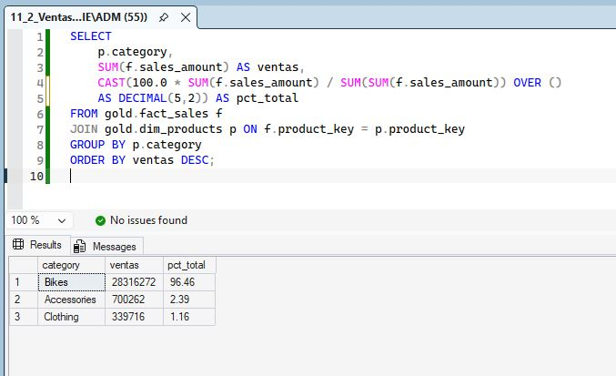

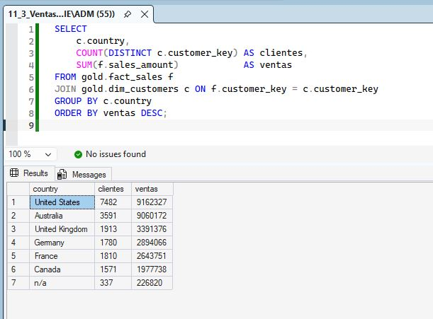

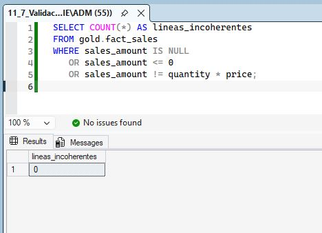

## 8. Desarrollo del dashboard Power BI

Se conectó **Power BI Desktop** a `DataWarehouse` en `localhost`, utilizando modo **Import** para las tres vistas Gold. En el modelo se establecieron dos relaciones **muchos a uno (`*:1`)**, activas y unidireccionales, desde las dimensiones hacia el hecho.

En Power BI las tablas importadas se identifican como `'gold fact_sales'`, `'gold dim_customers'` y `'gold dim_products'`.

### 8.1. Medidas DAX

```dax
Ventas Totales = SUM('gold fact_sales'[sales_amount])
Unidades Vendidas = SUM('gold fact_sales'[quantity])
Pedidos = DISTINCTCOUNT('gold fact_sales'[order_number])
Clientes con Compras = DISTINCTCOUNT('gold fact_sales'[customer_key])
Ticket Medio = DIVIDE([Ventas Totales], [Pedidos], 0)
```

### 8.2. Diseño y pruebas de interacción

El dashboard final incluye cuatro tarjetas KPI, seis gráficos y tres segmentadores desplegables (**Año**, **País**, **Categoría**). Se añadió un botón **Limpiar Filtros** para restaurar las selecciones de los segmentadores.

Entre las comprobaciones realizadas figuran:

- Contraste de las cuatro tarjetas con los resultados SQL.
- Pruebas combinando filtros por año, país y categoría.
- Verificación de que el botón de limpieza funciona mediante **Ctrl + clic** en Power BI Desktop cuando se está en modo edición.
- Revisión visual de etiquetas, marcadores y formato de los gráficos.
- Decisión de dejar desactivadas las etiquetas de datos del gráfico de evolución por solapamiento, conservando los marcadores y los tooltips.
- Inclusión de una nota explicativa sobre los periodos parciales de 2010 y 2014.
- Ajustes de fondo, tarjetas KPI, panel de filtros, bordes redondeados y sombras para un diseño coherente.


**Archivo de entrega:** [CicloNova_Dashboard.pbix](../powerbi/CicloNova_Dashboard.pbix).

## 9. Incidencias, decisiones y aprendizajes

| Situación encontrada | Decisión o solución aplicada |
|---|---|
| Primera carga desde CSV | Se corrigió la primera ingesta CRM antes de consolidar la carga automática Bronze. |
| Duplicados y valores inconsistentes en origen | Limpieza, normalización y validaciones específicas en Silver. |
| Fechas de pedido no disponibles | Se mantuvieron las 19 líneas y se documentó su exclusión de la evolución anual. |
| Siete pedales sin correspondencia de categoría ERP | Se conservaron los valores nulos y se registró la incidencia `CO_PE`. |
| Diferencias de representación entre SQL y Power BI | Se comprobaron relaciones, medidas DAX y resultados globales. |
| Botón de limpieza aparentemente inactivo | Se confirmó que, en modo edición de Power BI Desktop, requiere **Ctrl + clic**. |
| Etiquetas del gráfico temporal superpuestas | Se dejaron desactivadas para favorecer la lectura. |
| Ejecución programada en un entorno virtual | Se documentó la necesidad de mantener activos VM, motor SQL y SQL Server Agent. |

> Las capturas muestran pruebas realizadas durante el desarrollo. No se presentan como evidencias de monitorización productiva continua.

## 10. Documentación, versionado y entrega

La documentación se organizó en archivos Markdown con diagramas Mermaid y enlaces relativos; las evidencias se archivaron por capas y componente.

| Documento | Función |
|---|---|
| [README principal](../README.md) | Presentación general, resultados y entregables |
| [architecture.md](architecture.md) | Componentes y arquitectura Medallion |
| [data_lineage.md](data_lineage.md) | Recorrido y transformación de los datos |
| [data_model.md](data_model.md) | Modelo estrella y relaciones |
| [data_catalog.md](data_catalog.md) | Columnas y origen de los datos Gold |
| [naming_conventions.md](naming_conventions.md) | Criterios de nomenclatura |

**Verificaciones finales de entrega:** se revisaron los scripts `.sql`, las rutas de imágenes y los enlaces del README. Se descargó `CicloNova_Dashboard.pbix` desde GitHub y se abrió correctamente con Power BI Desktop **en un equipo diferente del utilizado para desarrollar el proyecto**. Abrir el `.pbix` confirma la integridad del archivo, pero **no significa que pueda actualizar los datos** sin acceso a la instancia SQL Server de origen.

Entregables:

- [Proyecto completo en GitHub](https://github.com/rafa7mad/IFCD0078_Bloque_02-Data_Engineering/tree/main/Proyecto_Final_CicloNova).
- [Presentación PowerPoint](../presentation/CicloNova_Presentacion_Final.pptx).
- [Archivo Power BI](../powerbi/CicloNova_Dashboard.pbix).
- [Scripts SQL](../scripts/) y [pruebas](../tests/).

## 11. Limitaciones y posibles ampliaciones

- **Recarga completa:** Bronze y Silver no implementan cargas incrementales.
- **Claves en vistas:** `ROW_NUMBER()` genera las claves Gold en consultas; la estabilidad de estas claves entre recargas no está garantizada.
- **Calidad de origen:** permanecen 19 fechas de pedido nulas y la incidencia de siete pedales sin categoría ERP.
- **Dependencia local:** una actualización desde otro equipo requiere acceso al SQL Server del entorno de origen.
- **Ejercicios pendientes/no incorporados en esta entrega:** tabla de auditoría `dbo.dwh_load_log` y vista `gold.report_customers` con segmentación VIP/Regular/New.

## 12. Cierre

CicloNova reúne el ciclo completo de un proyecto formativo de ingeniería de datos y análisis: **ingesta → limpieza → integración → calidad → automatización → análisis → visualización → documentación**. Esta memoria deja constancia de cómo se construyó y verificó la solución, mientras el README y los documentos de `docs/` describen la versión final del proyecto.
